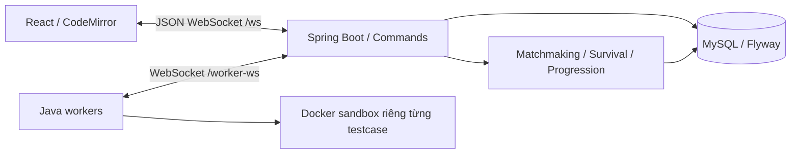

# CodeGrade Network 6.0.0

Ứng dụng luyện tập và thi đấu lập trình qua WebSocket. Java 21 / Spring Boot / JDBC, MySQL 8.4 / Flyway, React 18 / Vite / CodeMirror, Java worker và Docker sandbox.

Học phần Lập trình mạng, năm học 2026–2027. Thông tin nhóm nằm trong [báo cáo Word gốc](report/Bao_cao_CodeGrade_Network.docx). [Phụ lục kỹ thuật v6](report/CodeSurvival-v6.md) mô tả thay đổi, giao thức, kiểm thử và nội dung để nhóm đồng bộ vào báo cáo nộp chính thức.

## Chức năng

Practice cá nhân, Contest, ngân hàng đề, chấm bài và lịch sử, bảng xếp hạng, hồ sơ, bookmark, bình luận và quản trị ADMIN / AUTHOR / CODER được giữ. Một engine Code Survival dùng chung cho ba mode; không tạo game PvP riêng.

| Survival | Cách vào | Số người bắt đầu | EXP | Rating Survival |
|---|---|---:|---|---|
| PRACTICE — Giao lưu | Host tạo phòng, mời bằng mã | 2–10 | +5/trận; tối đa 30/ngày | Không đổi |
| NORMAL — Đấu thường | Server ghép queue | Đúng 5 | Theo thứ hạng | Không đổi |
| RANKED — Đấu Rank | Server ghép theo rating | Đúng 5 | Theo thứ hạng | Elo năm người |

Host Practice cấu hình tên, sức chứa 2–10, độ khó, thời gian vòng/chung kết 30–3600 giây. Normal/Ranked không nhận tạo/cấu hình/bắt đầu phòng thủ công và không cho người ngoài vào bằng mã.

## Kiến trúc mạng



Client gửi `{v:1,type,requestId,payload}`; server trả ACK sau commit và ghi EVENT bền vững để phát lại khi reconnect. `commands(user_id,request_id)` gắn requestId với fingerprint/phản hồi. Retry giữ nguyên requestId và payload. Khóa SQL `system_lock FOR UPDATE` tuần tự hóa admission, matchmaking, cutoff và settlement trên các tiến trình dùng chung database. Worker không giữ khóa trong lúc chạy code.

Giữ `received_at`, `admission_order`, snapshot đề/source, lease và lịch sử submission. Không tạo Receipt/Certificate mới, không trả chúng trong ACK/EVENT/snapshot. Replay cũ được lọc proof; `RECEIPT_GET` bị từ chối kể cả khi có command response cũ. Bảng legacy vẫn còn để bảo toàn dữ liệu.

### Survival engine

`LOBBY → COUNTDOWN → ROUND_ACTIVE → ROUND_GRADING → ROUND_RESULT → … → FINISHED`.

Khóa toàn bộ bank/phiên bản trước COUNTDOWN; chỉ chọn đề đã có validatedVersion khớp version. Mỗi người tối đa hai lượt chính thức/vòng. Đóng nhận bài khi hết giờ hoặc mọi người đã nộp; chờ verdict các bài hợp lệ. Người không AC bị loại; trong nhóm AC giữ tối đa `max(2,floor(0.7*n))`, riêng hai người giữ một. Hòa ở ranh giới dùng TIE_BREAK, giữ nguyên suất đã chắc chắn. Lỗi hạ tầng dùng RESCUE; không ai AC/hết đề cứu hộ thì UNRESOLVED, không thưởng/rating.

Chung kết có thể chốt sớm khi AC được xác nhận, nhưng phải chờ bài đến sớm hơn còn QUEUED/RUNNING. Worker chấm nhanh hơn không quyết định người thắng. Mất kết nối có 90 giây để quay lại; sau đó tính forfeit. Bỏ cuộc vẫn nằm trong roster/kết quả, rời sau khi bị loại không được nâng hạng. Phòng và lịch sử không bị xóa khi thành viên rời.

### Matchmaking

`WAITING → MATCH_FOUND → ACCEPTED → STARTED`, hoặc CANCELLED / EXPIRED / COMPLETED.

Queue bền vững trong SQL, khóa chính user_id ngăn một tài khoản có hai suất. Không đồng thời chờ/trong hai trận. Cần đủ năm người khác nhau và năm xác nhận mới đếm ngược. Hết hạn nhận trận (mặc định 20 giây), từ chối hoặc thiếu lease sẵn sàng trước vòng đầu: đóng phòng chưa bắt đầu, đưa người còn hợp lệ về queue và giữ thời điểm chờ cũ. Không dùng bot.

Normal ưu tiên Level gần nhau trong 10 giây đầu khi có nhiều lựa chọn, sau đó ưu tiên FIFO. Có đủ năm hợp lệ thì ghép ngay. Sáu người tạo một phòng và một người chờ; 10/15 người tạo 2/3 phòng.

| Ranked: thời gian chờ của người được xét trước | max(rating) − min(rating) của cả năm |
|---|---:|
| 0–<10 giây | 150 |
| 10–<20 giây | 250 |
| 20–<30 giây | 350 |
| Từ 30 giây | 400 |

Không so riêng từng người với một anchor rồi bỏ qua toàn nhóm; không tăng vô hạn sau 30 giây. Ưu tiên người chờ lâu, nhưng không để rating cô lập chặn nhóm khác hợp lệ. Queue heartbeat/lease 90 giây, lease sẵn sàng trước vòng đầu 30 giây. Reconnect đọc trạng thái chính thức, không dùng MATCH_FOUND cũ để tạo trận mới.

### Elo, EXP, Level

Survival rating khởi tạo 1000 trong `progression`, tách khỏi `users.elo` của Contest.

```text
E(i,j) = 1 / (1 + 10^((Rj − Ri)/400))
S = 1 nếu xếp trên; 0.5 nếu đồng hạng; 0 nếu xếp dưới
DeltaRi = round((K/4) × SUM_j≠i(S(i,j) − E(i,j)))
K mặc định = 32
```

Dùng snapshot rating trước trận của cả năm, chỉ settlement sau FINISHED trong một transaction. Năm rating 1000 với hạng 1,2,3,4,5 cho delta `+16,+8,0,−8,−16`. Thắng đối thủ rating thấp nhận ít hơn thắng đối thủ mạnh. Thứ hạng dựa mốc bị loại; các người cùng nhóm bị loại đồng hạng, không phá hòa bằng thời gian worker.

Bậc Đồng / Bạc / Vàng / Bạch Kim / Kim Cương / Cao Thủ có ngưỡng 1100 / 1300 / 1500 / 1700 / 1900.

| Nguồn EXP | Thưởng |
|---|---|
| AC cá nhân đầu tiên, mức 1–6 | 20 / 35 / 50 / 75 / 100 / 150 |
| Survival Practice | +5, tối đa 30/ngày theo Asia/Bangkok |
| Normal/Ranked, hạng 1–5 không hòa | 100 / 80 / 60 / 40 / 20 |

Đồng hạng chia trung bình EXP các vị trí bị chiếm: hai người hạng 4 nhận 30 mỗi người. Unique event key và khóa `(room_id,user_id)` chống thưởng/settlement trùng. Bài đã có trong solved trước nâng cấp không được farm EXP bằng nộp lại. Chạy thử, trận hủy và UNRESOLVED không thưởng. `Level = 1 + floor(sqrt(EXP/100))`; huy hiệu ở Level 2/5/10, khung silver/gold ở 5/10. Không tạo lợi thế về thời gian, lượt nộp hoặc quyền xem test.

## Editor thi đấu

Contest và cả ba mode Survival không đọc nháp server/localStorage và không autosave. Server xóa nháp legacy tương ứng trong transaction nhận SUBMIT chính thức. Sau ACK, client trả về starter chỉ khi scope (room/round hoặc contest/problem) và revision soạn thảo còn khớp. ACK muộn không xóa code mới/vòng khác. Mất ACK: retry cùng requestId để lấy kết quả đã commit. Submit bị từ chối/chạy thử giữ code. Practice cá nhân vẫn lưu nháp. Bản soạn chưa nộp trong thi đấu cũng không được phục hồi sau reload theo chính sách không lưu nháp này.

## Ngân hàng đề và nâng cấp dữ liệu

| Chủ đề | Cũ | Mới | Tổng |
|---|---:|---:|---:|
| Arithmetic | 20 | 34 | 54 |
| Arrays | 20 | 34 | 54 |
| Strings | 20 | 33 | 53 |
| Number Theory | 20 | 33 | 53 |
| Sequences | 20 | 33 | 53 |
| Graphs | 20 | 33 | 53 |
| **Tổng** | **120** | **200** | **320** |

[dataset.json](backend/src/main/resources/dataset.json): đúng 5 test/bài, tổng 1.600; một ví dụ công khai và bốn test ẩn. Bài cũ giữ mã v5, đề/đáp án; chọn lại test theo biên, trường hợp đặc biệt và độ đa dạng, không lấy năm test đầu. `dataset-upgrade-6.json` là bản gốc để so sánh nâng cấp, không phải test inactive của đề công bố.

200 bài v6 có phát biểu/contract/ví dụ tiếng Việt, độ khó 1–6, CPU/RAM và lời giải Python 3.11. [solutions/README.md](solutions/README.md) liệt kê đủ 120 lời giải C++11 cũ và 200 lời giải Python mới cùng phương pháp/độ phức tạp. C++11/17/20 và Python 3.11 đều tiếp tục là ngôn ngữ nộp bài. Một số bài khó có giới hạn nhỏ để dùng vét cạn tham chiếu.

Bootstrap, SeedBankUpgrade và SeedBankExpansion nâng cấp theo nội dung khớp bản gốc, giữ UUID/mã CG/bookmark và toàn bộ snapshot/verdict cũ. AUTHOR sửa khác: giữ nguyên, ghi SEED_V6_CONFLICT để người sở hữu rà soát. Đề trong bank đã khóa/contest đang diễn ra: DEFERRED, thử lại sau 60 giây. Trận cũ đang dùng snapshot nhiều test tiếp tục dùng nguyên snapshot đến khi kết thúc. Không sửa V1–V5, reset MySQL hoặc xóa volume. Các phiên bản mới vào queue VALIDATE thật trước khi đủ điều kiện Survival. ADMIN xem xung đột qua AUDIT.

Trạng thái database cũ sau nâng cấp: **315 bài đã có 5 testcase, 5 bài đang thuộc Contest chạy đến 14:05 ngày 31/10/2026 (UTC+7) được giữ nguyên**. Tổng hiện tại trong database cũ là 1.675 testcase; sau Contest, retry tự động chuẩn hóa về 1.600 và đưa phiên bản mới vào queue xác thực. Source và database tạo mới đã có 320 bài / 1.600 testcase. Không kết thúc hoặc sửa Contest để ép nâng cấp. Xem [đối chiếu dữ liệu thật](statics/results/project-upgrade-v6.json).

## Chạy Docker Compose

Cần Docker Desktop/Engine hoạt động. Môi trường kiểm thử có 12 CPU, 8 GiB Docker VM, bốn workers.

```powershell
# Chỉ tạo .env khi chưa có; giữ bí mật mật khẩu được sinh.
py -3.11 scripts/init_env.py --demo
docker compose up -d --build --scale worker=4
docker compose ps
docker compose logs --tail 50 server worker
```

Mở `http://localhost:8080`. `admin` dùng ADMIN_PASSWORD; `author`, `coder01`…`coder10` dùng DEMO_PASSWORD khi DEMO_DATA=true. Chờ worker xác thực bank lần đầu. Dừng giữ dữ liệu bằng `docker compose stop`; chạy lại `docker compose up -d`. Không chạy `down -v` hoặc tự đổi mật khẩu của volume cũ trong .env.

[.env.example](.env.example) liệt kê DB_PASSWORD, MYSQL_ROOT_PASSWORD, ADMIN_PASSWORD (10–72 ký tự), WORKER_TOKEN (≥32 ký tự), PORT, APP_ORIGINS và cấu hình:

```dotenv
SURVIVAL_RATING_RANGES=150,250,350,400
SURVIVAL_RANK_THRESHOLDS=1100,1300,1500,1700,1900
SURVIVAL_K_FACTOR=32
SURVIVAL_ACCEPT_SECONDS=20
```

Ngoài Docker: Java 21, Maven 3.9, Node ≥22.12; cấu hình DB_URL/DB_USER/DB_PASSWORD trong environment, `mvn spring-boot:run` tại backend, `npx vite` tại frontend. Proxy Vite nằm trong frontend/vite.config.js. Worker cần Docker và `WORKER_URL`, `WORKER_TOKEN`, `SANDBOX_IMAGE=codegrade-sandbox:5`; không có fallback chạy source người dùng trên host.

## Kiểm thử

```powershell
cd frontend
npm ci
npm test
npm run build
cd ../backend
mvn test
cd ..
# Cần Python 3.11 và g++ đủ c++11/17/20, hoặc image tools-test.
py -3.11 -X utf8 scripts/verify_dataset.py
py -3.11 -X utf8 scripts/generate_dataset.py
```

Các script `survival_smoke.py`, `judge_smoke.py`, `restart_smoke.py`, `benchmark_ws.py` dùng cho demo trong project Compose/file env riêng để không thêm trận thử vào lịch sử cá nhân. Xem tham số `--help`. Target tools-test trong Dockerfile có Python 3.11/g++/websockets; bind source vào /workspace và nối network của project kiểm thử. Script UI:

```powershell
$env:CG_ENV_FILE='đường dẫn file env kiểm thử'
$env:CG_UI_URL='http://localhost:18080'
node frontend/tests/survival-ui.cjs
```

Kết quả thực chạy ngày 29/10/2026:

| Kiểm tra | Kết quả | Bằng chứng |
|---|---|---|
| Backend | 90/90, không failure/error/skip | [verification-v6.json](statics/results/verification-v6.json) |
| Frontend | 68/68; Vite build đạt | [verification-v6.json](statics/results/verification-v6.json) |
| UI/server thật | 7 kiểm tra DOM đạt | [survival-v6-ui.json](statics/results/survival-v6-ui.json) |
| Tham chiếu | 1.000 lượt Python, 1.800 lượt C++, 125 kiểm tra độc lập | [dataset-v6-verification.json](statics/results/dataset-v6-verification.json) |
| Ba mode thật | Practice 2, Normal 5, Ranked 5 có forfeit | [survival-v6-smoke.json](statics/results/survival-v6-smoke.json) |
| Docker judge | AC bốn ngôn ngữ; WA/CE/TLE | [judge-v6-smoke.json](statics/results/judge-v6-smoke.json) |
| Restart thật | Queue/session/joinedAt và UUID/mã/version giữ nguyên | [restart-v6.json](statics/results/restart-v6.json) |
| Database cũ | Đối chiếu snapshot, verdict, UUID/mã và command sau nâng cấp | [project-upgrade-v6.json](statics/results/project-upgrade-v6.json) |
| Fairness | 10.000 mô phỏng: baseline sai cutoff 6.151, proposed 0 | [fairness-v6.json](statics/results/fairness-v6.json) |
| PING RTT | 1/10/30 client, tổng 820 ACK | [network-v6.json](statics/results/network-v6.json) |

PING p95 lần này: 14,362 / 18,084 / 200,664 ms. Đây không phải thông lượng judge hay tải matchmaking. Fairness là mô phỏng, không đo mạng. Baseline frontend đạt 70 test sau cài dependency; một lần backend đạt 65/66 với lỗi nạp resource dataset, bộ cuối 90/90 đạt. Báo cáo v5.5 trong thư mục results giữ như lịch sử, không dùng thay kết quả v6.

## Demo và đóng góp

1. Practice cá nhân: AC bài chưa làm, thấy EXP tăng một lần; nộp lại không tăng, reload còn nháp.
2. Practice Survival: hai CODER tạo/tham gia bằng mã, cấu hình host, bắt đầu và theo dõi judge/kết quả +5 EXP. Thử sức chứa tới 10.
3. Normal: bốn người còn chờ; người thứ năm vào, cả năm nhận trận rồi đếm ngược. Người thứ sáu tiếp tục chờ. Chỉ tăng EXP.
4. Ranked: quan sát mốc 10/20/30 nếu rating chưa khớp; nhận đủ năm, xem rating trước/sau. Từ chối trước trận trả người còn lại về queue; forfeit sau bắt đầu vẫn có thứ hạng.
5. Contest/Survival editor: thử không xóa code, SUBMIT được ACK về starter, reload không phục hồi source cũ; ACK muộn giữ phần code mới.

Đóng góp là cách tích hợp admission bền vững, event replay, lease, cutoff, engine ba mode và settlement có unique event key vào ứng dụng học lập trình. Elo, gamification, WebSocket và Docker là kỹ thuật có sẵn, không phải thuật toán mới của nhóm.

Giới hạn: khóa toàn cục là điểm nghẽn mở rộng; chưa chứng minh HA đa server; Docker socket cần môi trường tin cậy; chưa có chống đạo văn/giám sát gian lận đầy đủ; năm testcase không bảo đảm bao phủ mọi lỗi. UI được kiểm tra DOM, chưa kiểm thử bố cục native: khởi chạy Edge tự động bị môi trường chặn. Xung đột AUTHOR cần chủ sở hữu rà soát. Nhóm cần đồng bộ phụ lục v6 vào báo cáo Word và hoàn tất các bước học thuật theo [INSTRUCTION.md](INSTRUCTION.md).
