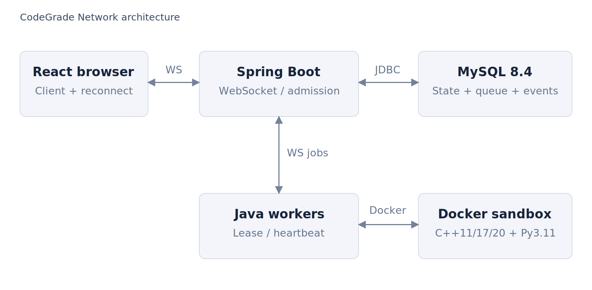
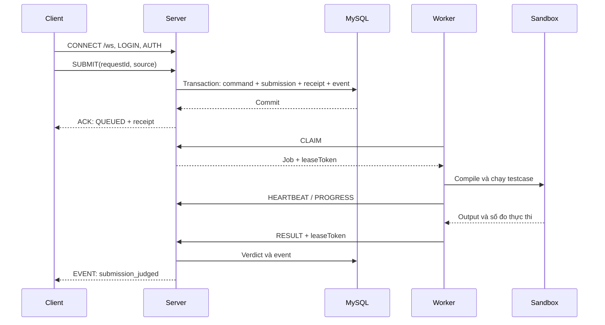

# NETWORK PROGRAMMING – FINAL PROJECT

> **Academic Year 2026–2027** · **CodeGrade Network 5.5.2**

Tài liệu này mô tả bản mã nguồn chạy bằng Docker, dựa trên báo cáo [Bao_cao_CodeGrade_Network.docx](report/Bao_cao_CodeGrade_Network.docx). Các trường **[CẦN ĐIỀN: …]** dành cho nhóm bổ sung; danh sách tập trung ở mục 23.

---

# 1. Project Information

## 1.1. Project Name

**CodeGrade Network — Xây dựng hệ thống luyện tập và thi đấu lập trình trực tuyến theo mô hình client server.**

## 1.2. Topic

**Chủ đề 3 – Ứng dụng mạng**, định hướng **Networked Auto-Grader** trong [TOPICS.md](TOPICS.md), mục 4.5.

Mã đề tài đã đăng ký nếu lớp có quy định riêng: **[CẦN ĐIỀN: mã đề tài hoặc xác nhận dùng tên chủ đề trên]**.

## 1.3. Group

- Số nhóm: **[CẦN ĐIỀN: số nhóm chính thức]**.
- Nhóm lớp học phần: **[CẦN ĐIỀN: mã lớp/nhóm lớp]**.
- Đơn vị: Học viện Công nghệ Bưu chính Viễn thông, Khoa Công nghệ Thông tin 1.

| No. | Student ID | Full Name | Email | Main Responsibility | Contribution |
| --- | --- | --- | --- | --- | ---: |
| 1 | B23DCCN564 | Phạm Xuân Minh | **[CẦN ĐIỀN: email Minh]** | M02 — Ngân hàng đề và soạn đề; M03 — Luyện tập, chấm bài và lịch sử; M05 — Code Survival | 50% |
| 2 | B23DCCN464 | Nguyễn Trung Kiên | **[CẦN ĐIỀN: email Kiên]** | M01 — Tài khoản, cộng đồng và quản trị; M04 — Contest và bảng điểm; M06 — Biên nhận và chứng thư | 50% |
| | | | | **Total** | **100%** |

Phân công theo module được thống nhất với Bảng 0.1 của báo cáo, chi tiết ở mục 20. Mỗi người phụ trách trọn luồng giao diện, nghiệp vụ, dữ liệu và kiểm thử của module mình. Tỷ lệ giữ 50/50; hai thành viên cần xác nhận theo công việc thực tế trước khi nộp.

## 1.4. Instructor

**[CẦN ĐIỀN: họ tên giảng viên học phần Lập trình mạng]**.

---

# 2. Project Summary

## 2.1. Problem

Nhiều client cần gửi mã nguồn, nhận kết quả chấm và theo dõi cùng một trạng thái thi đấu qua mạng. ACK có thể thất lạc sau khi server đã lưu bài; worker có thể hoàn thành bài đúng hạn sau deadline. Hệ thống phải tránh nộp trùng và tránh dùng độ trễ chấm để quyết định người đi tiếp.

## 2.2. Motivation

Tách tiếp nhận khỏi thực thi giúp giao diện nhận xác nhận sớm, worker xử lý công việc dài và server giữ quyền quyết định trạng thái. Biên nhận và chứng thư vòng giúp đối chiếu các bài đã được nhận khi kết thúc vòng đấu.

## 2.3. Objectives

1. Triển khai client–server nhiều kết nối với giao thức JSON/WebSocket có requestId, ACK và EVENT.
2. Lưu bài bền vững, xử lý retry có tính lặp an toàn và khôi phục phiên/sự kiện khi nối lại.
3. Chấm C++11/17/20 và Python 3.11 trong Docker sandbox thông qua worker có lease.
4. Hỗ trợ luyện tập, contest và Survival; xếp hạng Survival theo thời điểm tiếp nhận.
5. Kiểm chứng chức năng, đo RTT giao thức và mô phỏng baseline; công bố đúng phạm vi bằng chứng.

## 2.4. Scope

### In scope

- Ba vai trò ADMIN, AUTHOR, CODER; quản lý đề, testcase, tài khoản và lịch sử.
- Editor, nhập/xuất đề JSON, chạy ví dụ, nộp bài, tiến độ chấm và bảng xếp hạng.
- Contest và Code Survival 5–10 Coder, snapshot đề, deadline do server quản lý.
- Queue trong SQL, worker, sandbox và biên nhận Ed25519.

### Out of scope

- Phát hiện đạo văn mã nguồn, giám sát webcam hoặc chống gian lận hoàn chỉnh.
- Nhiều server điều phối, HA, sharding và triển khai nhiều trung tâm dữ liệu.
- Thực thi Twig/combinator/attachment của Moodle; một số trường chỉ được giữ trong draft.
- Cam kết tải Internet hoặc thông lượng chấm khi chưa có phép đo tương ứng.

---

# 3. System Overview

## 3.1. System Description

Trình duyệt chạy React và kết nối tới Spring Boot qua `/ws`. Server xác thực, kiểm tra nghiệp vụ, ghi command/submission/event vào MySQL. Worker Java kết nối `/worker-ws`, nhận bài bằng lease và gọi Docker để chạy từng testcase. Server so sánh output, lưu verdict và gửi EVENT cho client.

## 3.2. Target Users

| Vai trò | Đối tượng và quyền chính |
| --- | --- |
| ADMIN | Quản lý người dùng, danh mục, đề và thông báo |
| AUTHOR | Soạn đề, testcase, đáp án mẫu và quản lý cuộc thi theo quyền |
| CODER | Luyện tập, xem lịch sử, tham gia contest và Survival |

## 3.3. Main Functions

| Function | Description | Status |
| --- | --- | --- |
| Tài khoản | Đăng ký, đăng nhập, phân quyền, đổi mật khẩu | Đã triển khai |
| Kho bài | Tìm theo mã CG, lọc chủ đề/độ khó, bookmark và bình luận | Đã triển khai |
| Soạn đề | Testcase, grader, ví dụ, nhập/xuất JSON và validate mẫu | Đã triển khai |
| Chấm bài | Queue, lease, tiến độ từng test, verdict và lịch sử | Đã triển khai |
| Survival | 5–10 Coder, loại vòng, vòng phụ và chứng thư | Đã triển khai |
| Contest | Đăng ký/duyệt, thời gian thi, bảng điểm và Elo | Đã triển khai |
| Khôi phục mạng | AUTH lại, replay EVENT theo seq và SYNC | Đã triển khai |
| Bằng chứng | Receipt và manifest có chữ ký Ed25519; hiển thị thành thẻ thông tin và bảng đối chiếu dễ đọc | Đã triển khai |

“Đã triển khai” mô tả mã nguồn; kết quả kiểm thử được trình bày riêng ở mục 14.

---

# 4. System Architecture

## 4.1. Architecture Diagram



Bản vector: [architecture.svg](statics/architecture.svg).

## 4.2. Components

| Component | Responsibility |
| --- | --- |
| Client | React, CodeMirror, gửi lệnh, nhận ACK/EVENT và reconnect |
| Server | Spring Boot; xác thực, admission, contest, Survival và phát sự kiện |
| Database | MySQL 8.4; trạng thái, queue, command ledger, event log và khóa ký |
| Service | Các module auth, catalog, room, judge, db và protocol trong backend |
| Worker | Java; CLAIM, HEARTBEAT, PROGRESS, RESULT; không kết nối trực tiếp MySQL |
| Sandbox | Container mới cho từng testcase; compiler, watchdog và giới hạn tài nguyên |

## 4.3. Data Flow

1. Client gửi SUBMIT gồm UUID đề, ngôn ngữ, source và requestId.
2. Server kiểm tra quyền, quota, deadline; lưu snapshot, trạng thái QUEUED, receipt và phản hồi command trong giao dịch.
3. Sau commit, server trả ACK. Worker nhận lease và thực thi ngoài giao dịch.
4. Worker báo tiến độ/output; server giữ expected output và quyết định verdict.
5. Server lưu kết quả, phát EVENT và cập nhật lịch sử/bảng điểm.
6. Survival chờ các bài đúng hạn có kết quả rồi chốt vòng, ký manifest.

`Store.atomic` dùng transaction JDBC và `SELECT ... FOR UPDATE` trên `system_lock` để tuần tự hóa admission/settlement. Compile/chạy mã không giữ khóa này.

---

# 5. Network Communication Design

## 5.1. Communication Model

```text
Browser clients <-- HTTP + JSON/WebSocket /ws --> Spring Boot
                                                     |
                                                  JDBC/TCP
                                                     |
                                                  MySQL 8.4
                                                     ^
                                                     | server truy cập DB
Java workers <-- JSON/WebSocket /worker-ws --> Spring Boot
     |
Docker Engine socket --> sandbox riêng cho từng testcase
```

## 5.2. Protocol

- HTTP phục vụ frontend, `GET /api/health` và `GET /api/meta`.
- WebSocket text message, JSON v1, dùng TCP; production qua reverse proxy có thể dùng HTTPS/WSS.
- Client: `ws://localhost:8080/ws`; worker trong Compose: `ws://server:8080/worker-ws`.
- Client dùng token phiên; worker dùng WORKER_TOKEN riêng.
- Mặc định chỉ publish cổng HTTP lên `127.0.0.1`; MySQL không publish ra host.

## 5.3. Message Format

Request tối thiểu, có thể gửi trước đăng nhập:

```json
{"v":1,"type":"PING","requestId":"ping-01","payload":{}}
```

ACK thành công (timestamp minh họa cấu trúc, không phải số đo):

```json
{"v":1,"type":"ACK","requestId":"ping-01","command":"PING","ok":true,"data":{"serverTime":0},"serverTime":0}
```

Request nộp bài sau LOGIN và AUTH:

```json
{"v":1,"type":"SUBMIT","requestId":"submit-01","payload":{"problemId":"<UUID đề>","language":"CPP17","source":"<mã nguồn>"}}
```

ACK lỗi chứa `ok:false` và `error:{code,message}`. EVENT có `v,type:"EVENT",seq,event,data,serverTime`. Ví dụ event: `submission_received`, `submission_running`, `submission_progress`, `submission_judged`.

Worker dùng `WORKER_AUTH → CLAIM → HEARTBEAT/PROGRESS → RESULT`; phản hồi worker có `requestId,ok,data` hoặc `error`. Không áp dụng nguyên envelope ACK của client cho kênh worker.

Mutation được ràng buộc theo user và requestId cùng fingerprint nội dung. Retry phải dùng lại cùng requestId/payload; cùng ID với nội dung khác bị từ chối.

## 5.4. Communication Sequence



Client PING mỗi 15 giây. Khi mất kết nối, reconnect tăng từ 0,5 đến tối đa 10 giây; AUTH gửi token/lastSeq, sau đó SYNC trạng thái. Đóng tab đóng transport; LOGOUT thu hồi phiên.

## 5.5. Error Handling

| Tình huống | Cách xử lý |
| --- | --- |
| JSON/version/requestId/payload sai | ACK lỗi; một request sai không chủ động kết thúc server |
| Chưa AUTH, thiếu quyền, dữ liệu sai | Từ chối tại server, trả mã lỗi phù hợp |
| Mất ACK/mất mạng | Retry mutation cùng ID; replay sự kiện và SYNC khi reconnect |
| Không nhận ACK | Client timeout sau 30 giây; không suy ra rằng server chưa lưu bài |
| Worker mất kết nối | Lease 30 giây, heartbeat mỗi 5 giây; hết hạn đưa bài lại queue |
| Kết quả worker cũ | Từ chối khi worker/leaseToken/trạng thái/thời hạn không khớp |
| Hạ tầng chấm lỗi | Thử lại tối đa 3 lượt nhận việc; kết thúc SE khi không phục hồi được |
| Database/server lỗi | Giao dịch rollback; ACK SERVER_ERROR khi còn gửi được, ghi log server |
| Quá tải | Mặc định queue 500, tối đa 4 bài pending/user, giới hạn message và tốc độ |

Client có giới hạn 250 kết nối, 80 message/10 giây/kết nối và 20 LOGIN/REGISTER/phút/IP. Các giới hạn là cấu hình/điều kiện trong code, không phải kết quả đo năng lực phục vụ.

---

# 6. Technology Stack

| Category | Technology |
| --- | --- |
| Language | Java 21, JavaScript/JSX, Python 3.11 trong sandbox, C++ cho bài nộp |
| Network | HTTP, JSON/WebSocket, JDBC trên TCP |
| Backend | Spring Boot 3.5.7, Spring JDBC, Spring Security Crypto, Flyway, RE2/J 1.8 |
| Frontend | React 18.3.1, Vite 7.1.12, CodeMirror 6 qua @uiw/react-codemirror 4.25.9 |
| UI assets | Font Awesome 6.7.2; Inter, Manrope, JetBrains Mono; giấy phép tại frontend/public/licenses |
| Database | MySQL 8.4; H2 chỉ cho kiểm thử backend |
| Build Tool | Maven 3.9.11, Node 22, npm ci, Docker BuildKit và Compose |
| Test | JUnit 5, Node test runner, JSDOM 26.1.0, websockets 15.0.1 |
| IDE | **[CẦN ĐIỀN: IDE nhóm sử dụng]** |
| OS | Windows/Linux với Docker chạy Linux containers |

Phiên bản trực tiếp và dependency khóa nằm trong [pom.xml](backend/pom.xml), [package.json](frontend/package.json), [package-lock.json](frontend/package-lock.json) và [requirements.txt](scripts/requirements.txt).

---

# 7. Novelty and Contributions

## 7.1. Baseline

Baseline của thí nghiệm fairness chọn các bài hoàn thành sớm nhất khi độ trễ worker khác nhau. Đây là mô hình so sánh do nhóm xác định, không phải khẳng định DOMjudge/Kattis dùng cơ chế này. Luồng online judge tham khảo được mô tả trong [DOMjudge](https://www.domjudge.org/docs/manual/8.2/judging.html).

## 7.2. Proposed Improvement

Server ghi thời điểm admission trong giao dịch, giữ snapshot đề, chờ verdict của bài đúng hạn và xếp theo receivedAt thay vì completedAt. Receipt của từng bài cùng manifest khi chốt vòng giúp người chơi đối chiếu bài đã nhận.

## 7.3. Contributions

| No. | Contribution | Description | Evidence |
| --- | --- | --- | --- |
| 1 | Retry không tạo trùng | Lưu fingerprint và phản hồi command cùng thay đổi nghiệp vụ | Commands.java, SystemIntegrationTest |
| 2 | Admission độc lập chấm trễ | Xếp hạng theo lúc nhận, cộng 10 giây/lần sai trước AC | RoundRanking.java, FairnessExperimentTest |
| 3 | Phục hồi worker | Lease, heartbeat và loại kết quả từ lease cũ | Submissions.java, WorkerSocket.java |
| 4 | Receipt + manifest | Ký payload UTF-8 gốc, đối chiếu tập bài của vòng | ReceiptLedger.java, verify_certificate.cjs và 3 test |
| 5 | Khôi phục client | AUTH với cursor, replay event và SYNC | LiveClient, ClientSocket, live.test.js |

## 7.4. Baseline vs Proposed

| Aspect | Baseline của mô phỏng | Proposed |
| --- | --- | --- |
| Architecture | Cùng dữ liệu thời điểm nhận và độ trễ giả lập | Cùng dữ liệu, dùng hàm ranking production |
| Algorithm | Chọn theo thời điểm hoàn thành | Chọn theo receivedAt |
| Communication | Không mô phỏng packet loss/Internet | Tách thí nghiệm PING khỏi mô phỏng ranking |
| Performance | Không đo throughput chấm | Chưa kết luận nhanh hơn từ mô phỏng |
| Functionality | Không có chứng cứ admission trong baseline | Receipt và manifest được triển khai trong sản phẩm |

WebSocket, queue, lease và Ed25519 là kỹ thuật có sẵn; đóng góp của đề tài nằm ở cách tích hợp và các thuộc tính đã kiểm tra.

---

# 8. Project Structure

```text
Source/
├── README.md
├── INSTRUCTION.md / TOPICS.md
├── Dockerfile / compose.yaml / compose.test.yaml
├── .env.example / .dockerignore / .gitignore
├── backend/
│   ├── pom.xml
│   └── src/
│       ├── main/java/vn/codegrade/   # auth, catalog, config, db, judge, protocol, room
│       ├── main/resources/          # application.yml, dataset*.json, db/migration V1–V5
│       └── test/                    # JUnit + cấu hình H2
├── frontend/
│   ├── src/                         # React, LiveClient, editor và trang nghiệp vụ
│   ├── public/                      # Ảnh nền và giấy phép
│   ├── tests/                       # Unit test và DOM integration
│   └── package*.json / index.html / vite.config.js
├── worker/                          # Dockerfile sandbox và sandbox.py
├── scripts/                         # Khởi tạo, kiểm thử, benchmark, đóng gói
├── statics/
│   ├── architecture.png / architecture.svg
│   └── results/                     # Kết quả gốc và kết quả chạy lại
└── report/
    └── Bao_cao_CodeGrade_Network.docx
```

`.env` là cấu hình của máy đang chạy, không đưa vào gói nộp. Frontend được build và chép vào JAR bên trong Docker; không cần lưu dist, target hoặc JAR dựng sẵn trong source. Lời giải mẫu/testcase nằm trong tài nguyên backend, không đưa vào frontend/public.

---

# 9. Requirements

## Hardware

Cấu hình gợi ý cho demo cục bộ, chưa phải yêu cầu tối thiểu đã đo: CPU 4 luồng trở lên, RAM 8 GB trở lên và ít nhất 10 GB dung lượng trống cho Docker images/cache. Tăng số worker cần thêm CPU/RAM.

## Software

- Docker Engine/Docker Desktop đang hoạt động, Linux containers, BuildKit và Docker Compose hỗ trợ `service_completed_successfully`.
- Trình duyệt hiện đại có WebSocket; Internet để tải image/dependency lần build đầu.
- Python 3.11+ nếu chạy script khởi tạo/đóng gói trực tiếp trên host; có lệnh khởi tạo bằng Docker ở mục 10.
- Java/Maven/Node/Python/g++ cho ứng dụng và test đã có trong Docker images; không bắt buộc cài trên host khi dùng các lệnh Docker dưới đây.
- Node >=22.12, JDK 21 và Maven nếu chọn phát triển/chạy unit test ngoài Docker.

---

# 10. Installation

## 10.1. Clone / Download

Giải nén gói source, mở terminal tại thư mục chứa `compose.yaml`.

Repository của nhóm nếu công bố: **[CẦN ĐIỀN: URL repository hoặc ghi “Nộp source bằng Google Drive”]**.

## 10.2. Install Dependencies

```powershell
docker version
docker compose version
```

Nếu chưa có `.env`, tạo cấu hình demo bằng Python:

```powershell
python scripts/init_env.py --demo
```

Hoặc dùng Docker để không cần Python trên host (PowerShell):

```powershell
docker run --rm -v "${PWD}:/workspace" -w /workspace python:3.11-slim-bookworm python scripts/init_env.py --demo
```

Script giữ nguyên `.env` đã tồn tại. Nếu cấu hình hiện tại chưa bật demo, tự chỉnh `DEMO_DATA=true` và `DEMO_PASSWORD` hợp lệ trước khi khởi động. Có thể điền thủ công theo [.env.example](.env.example).

```powershell
docker compose config --quiet
docker compose build
```

Docker tự cài dependency theo lockfile/pom; không cần cài riêng MySQL, compiler hay frontend trên host.

## 10.3. Database Setup

Compose tạo database `codegrade` và user `codegrade`. Flyway tự chạy các migration [V1–V5](backend/src/main/resources/db/migration) khi server khởi động.

Volume `mysql_data` giữ dữ liệu, tài khoản và khóa ký qua các lần chạy. Không dùng `docker compose down -v` khi cần giữ dữ liệu. Đổi mật khẩu trong .env không tự đổi tài khoản MySQL đã khởi tạo trong volume cũ.

## 10.4. Configuration

| Biến | Ý nghĩa | Giá trị/điều kiện |
| --- | --- | --- |
| PORT | Cổng HTTP trên host | Mặc định 8080 |
| DB_PASSWORD | Mật khẩu user MySQL codegrade | Bắt buộc, điền riêng |
| MYSQL_ROOT_PASSWORD | Mật khẩu MySQL root | Bắt buộc, khác mật khẩu ứng dụng |
| ADMIN_PASSWORD | Mật khẩu admin khi tạo tài khoản lần đầu | 10–72 ký tự |
| WORKER_TOKEN | Bí mật xác thực server–worker | Ít nhất 32 ký tự |
| DEMO_DATA | Tạo author, coder01…coder10 và kho mẫu | true cho demo; mặc định false |
| DEMO_PASSWORD | Mật khẩu các tài khoản demo khi được tạo | 10–72 ký tự nếu DEMO_DATA=true |
| APP_ORIGINS | Danh sách origin được phép kết nối /ws | localhost và 127.0.0.1, kèm đúng cổng |

Compose cấp sẵn DB_URL/DB_USER cho server, WORKER_URL/SANDBOX_IMAGE cho worker. MAX_QUEUE mặc định 500 trong application.yml; muốn thay qua Compose phải thêm biến vào environment của server. Không ghi mật khẩu/token thật vào README hoặc ảnh minh chứng.

---

# 11. Running the Project

## 11.1. Start Server

```powershell
docker compose up -d --build
docker compose ps -a
docker compose logs --tail 50 server worker
```

Server/MySQL cần healthy, worker có log `Worker connected`. Service `sandbox` chạy lệnh true rồi `Exited (0)` là bình thường: service này bảo đảm image được build; worker tạo container khác cho từng testcase.

Tăng số worker:

```powershell
docker compose up -d --scale worker=2
```

Dừng và giữ dữ liệu:

```powershell
docker compose down
```

## 11.2. Start Client

Mở **http://localhost:8080**. Frontend đã nằm trong server; không cần mở Vite riêng.

| Tài khoản | Vai trò | Mật khẩu |
| --- | --- | --- |
| admin | ADMIN | ADMIN_PASSWORD trong .env, khi tài khoản được tạo lần đầu |
| author | AUTHOR | DEMO_PASSWORD |
| coder01 … coder10 | CODER | DEMO_PASSWORD |

Các tài khoản demo cần DEMO_DATA=true. Lần đầu khởi tạo, chờ worker xác thực lời giải mẫu trước khi bắt đầu Survival.

## 11.3. Start Multiple Clients

Dùng các hồ sơ trình duyệt/cửa sổ độc lập, đăng nhập coder01…coder05 để có tối thiểu 5 Coder. Kiểm tra tài khoản trong từng cửa sổ sau khi sao chép tab.

Demo LAN cần sửa mapping `127.0.0.1:...` trong compose.yaml thành IP LAN hoặc 0.0.0.0, thêm origin `http://IP-SERVER:8080` vào APP_ORIGINS, mở firewall và khởi động lại. Cấu hình mặc định chỉ dùng trên máy server.

## 11.4. Run Test

Bắt đầu từ thư mục Source; khởi động ứng dụng trước các kiểm tra mạng và worker:

```powershell
docker compose -f compose.test.yaml build
docker compose -f compose.test.yaml run --rm frontend-test
docker compose -f compose.test.yaml run --rm frontend-test node --test /checks/receipt-verification.test.cjs
docker compose -f compose.test.yaml run --rm backend-test
docker compose -f compose.test.yaml run --rm tools-test
docker compose -f compose.test.yaml run --rm tools-test python scripts/judge_smoke.py --url ws://server:8080/ws --output /results/judge-smoke.json
docker compose -f compose.test.yaml run --rm tools-test python scripts/verify_dataset.py --jobs 2 --report /results/dataset-rerun.json
```

- backend-test dùng H2 tách khỏi MySQL của ứng dụng; xuất fairness-rerun.json.
- tools-test mặc định chạy benchmark PING, xuất network-rerun.json.
- judge_smoke nộp **7 bài thật** vào lịch sử của coder01; chỉ chạy trên dữ liệu demo phù hợp.
- verify_dataset chạy mã tham chiếu tin cậy trong container kiểm chứng; không dùng đường chạy này cho mã nộp tùy ý.
- Kết quả mới được ghi vào statics/results; giữ nguyên các JSON gốc để đối chiếu.
- Health trên PowerShell: `Invoke-RestMethod http://localhost:8080/api/health`.

Các script khác:

| File | Mục đích |
| --- | --- |
| init_env.py | Sinh cấu hình riêng, không ghi đè .env đang có |
| benchmark_ws.py | Đo RTT PING 1/10/30 client; có --url, --clients, --rounds, --output |
| judge_smoke.py | Xác nhận C++11/17/20, Python AC và Python WA/CE/TLE qua server/worker thật |
| verify_certificate.cjs | Xác minh manifest/receipt bằng khóa công khai đã tin cậy |
| receipt-verification.test.cjs | Test chữ ký hợp lệ, omission và payload bị sửa |
| verify_dataset.py | Đối chiếu oracle, C++11/17/20, UBSan và vét cạn; lấy sampleAnswer từ dataset |
| generate_dataset.py | Bảo trì/tái tạo ngân hàng; có ghi lại tài nguyên và xuất solutions, không chạy khi cài demo |
| package_release.py / verify_release.py | Đóng gói source/report và kiểm tra SHA-256 |

DOM integration được giữ tại frontend/tests/ui-integration.cjs để kiểm tra trên database demo riêng khi phát triển; cần npm ci, npm run build và CG_UI_PASSWORD/CG_UI_URL. Script có tạo đề/phòng/contest. Kết quả DOM gốc không được hiểu là kiểm tra giao diện native của bản hiện tại.

---

# 12. Main Features

| No. | Feature | Description | Test |
| --- | --- | --- | --- |
| 1 | Giao tiếp client–server | HTTP health, WebSocket PING và ACK | Đã kiểm tra Docker và đo mạng |
| 2 | Editor và logic client | Coderunner, locale, insights, reconnect, đồng hồ | Unit test frontend |
| 3 | Chấm bài thật | C++11/17/20, Python, AC/WA/CE/TLE | judge-smoke.json khi chạy thành công |
| 4 | Schema/command/quyền | Migration, admission, idempotency và nghiệp vụ | JUnit/H2 |
| 5 | Ranking Survival | receivedAt, penalty và chọn suất | RoundRankingTest và mô phỏng fairness |
| 6 | Receipt/manifest | Chữ ký, omission, tampering | 3 fixture test |
| 7 | Contest/Survival/giao diện | Các màn hình và luồng nhiều người | Có test nghiệp vụ; cần demo browser và ảnh thật |

---

# 13. Experimental Setup

## 13.1. Environment

Hai môi trường được ghi riêng:

| Nội dung | Kết quả gốc kèm báo cáo | Kiểm tra Docker hiện tại |
| --- | --- | --- |
| OS | Linux 6.18.55 x86_64, glibc 2.39 | Host Windows 11 Pro; Linux containers |
| CPU/RAM | 9 CPU logic được môi trường hiển thị; chưa có RAM vật lý | Intel i5-12450H, 12 luồng; RAM host khoảng 15,7 GB |
| Runtime | Temurin 21.0.13, Node 24.22.1, Python 3.12.14 | Java 21, Node 22 và Python 3.11 trong image |
| Database | H2 2.3.232 MySQL mode | MySQL 8.4 cho ứng dụng; H2 cho JUnit |
| Network | Loopback | Docker bridge nội bộ/loopback tùy lần đo |

Máy demo khi bảo vệ, giới hạn tài nguyên Docker, trình duyệt và mạng thực tế: **[CẦN ĐIỀN: cấu hình demo cuối]**. Không suy RAM/CPU cấp cho container chỉ từ cấu hình host.

## 13.2. Dataset

[dataset.json](backend/src/main/resources/dataset.json) có **120 bài, 2.394 testcase**, gồm 6 chủ đề × 20 bài: Arithmetic, Arrays, Strings, NumberTheory, Sequences và Graphs. Phân bố 6 mức khó trong dữ liệu kiểm chứng gốc: 36, 37, 26, 14, 6, 1.

Đáp án tham chiếu C++11 nằm trong sampleAnswer của từng đề; backend giữ testcase và expected output. Dataset-localization và dataset-upgrade phục vụ tương thích/nâng cấp dữ liệu cũ.

## 13.3. Test Scenarios

### Scenario 1 — Chức năng và chấm thực

Chạy frontend/JUnit/receipt test, kiểm tra startup/migration/health/worker; judge_smoke gửi lời giải đúng cho bốn ngôn ngữ và chương trình gây WA, CE, TLE.

### Scenario 2 — Nhiều client WebSocket

Mỗi client gửi 50 PING nối tiếp ở các mức 1, 10, 30 client. Script lưu RTT thô, p50, p95, max, số ACK/lỗi và thời gian đo. Đây là tải giao thức, không phải tải chấm bài.

### Scenario 3 — Fairness có seed cố định

10.000 lượt, 10 Coder, 7 suất, seed 20261024; thời điểm nhận 1.000–119.000 ms, độ trễ worker 0–60.000 ms, tất cả bài giả định AC. So baseline theo lúc hoàn thành với hàm RoundRanking production.

### Scenario 4 — Cô lập và phục hồi khi lỗi

Bộ smoke xác nhận kết quả chạy mã cơ bản. Fault injection worker chết/DB mất kết nối/deadline trên hạ tầng thật và demo browser cần ghi nhận riêng theo Phụ lục C của báo cáo; không thay bằng test fixture.

## 13.4. Evaluation Metrics

- Giao thức: ACK thành công, lỗi, RTT p50/p95/max và ACK mỗi giây.
- Chấm bài: verdict, thời gian từ gửi đến kết thúc; compileMs/timeMs do sandbox báo.
- Fairness: số lượt chọn sai tập đi tiếp; bài đúng hạn hoàn thành sau deadline.
- Dataset: số testcase khớp, số lượt C++/UBSan/vét cạn và SHA-256 dataset.
- Queue wait, worker utilization, CPU/RAM theo tải: **chưa có benchmark tổng hợp**, không suy ra từ RTT PING.

---

# 14. Experimental Results

## 14.1. Functional Results

Kết quả **gốc** trong [verification.json](statics/results/verification.json): 55 JUnit, 59 frontend, 23 DOM và 3 kiểm tra chữ ký. Source hiện tại đã có thêm ca kiểm thử. Lần chạy lại ngày **27/10/2026** cho kết quả:

| Kiểm tra hiện tại | Kết quả | Phạm vi |
| --- | --- | --- |
| JUnit | 66/66, không lỗi | H2, migration V1–V5, nghiệp vụ, ranking và fairness |
| Frontend | 70/70, không lỗi | Node unit test và render biên nhận/chứng thư; kiểm tra bố cục trình duyệt được ghi riêng |
| Receipt/manifest | 3/3 | Fixture chữ ký, omission và tampering |
| Judge smoke | 7/7 | MySQL + server + Java worker + Docker sandbox; 4 AC và WA/CE/TLE |
| Ngân hàng đề | 7.182 lượt C++, 2.394 UBSan, 750 vét cạn, 120 chương trình độc lập | Mã tham chiếu tin cậy trong container kiểm chứng |

[verification-rerun.json](statics/results/verification-rerun.json) ghi tóm tắt kiểm tra hiện tại; [judge-smoke.json](statics/results/judge-smoke.json), [dataset-rerun.json](statics/results/dataset-rerun.json) và [fairness-rerun.json](statics/results/fairness-rerun.json) chứa kết quả chi tiết. Các kết quả mới không tự thay thế số liệu/môi trường trong bản Word.

Ảnh giao diện thật cho bản nộp: **[CẦN ĐIỀN: đường dẫn ảnh demo sau khi chụp]**. Các hình mô phỏng Chương 7 trong báo cáo cần thay bằng ảnh thực tế; chưa đánh dấu hoàn tất việc này.

## 14.2. Performance Results

Kết quả PING **gốc**, nguồn [network.json](statics/results/network.json), tổng 2.050 ACK, 0 lỗi:

| Client | ACK | p50 ms | p95 ms | Max ms |
| ---: | ---: | ---: | ---: | ---: |
| 1 | 50 | 0,361 | 0,988 | 26,287 |
| 10 | 500 | 0,808 | 3,120 | 79,026 |
| 30 | 1.500 | 2,169 | 7,392 | 103,409 |

Kết quả đo lại ngày **27/10/2026** qua Docker bridge, nguồn [network-rerun.json](statics/results/network-rerun.json), cũng ghi nhận 2.050 ACK và 0 lỗi:

| Client | ACK | p50 ms | p95 ms | Max ms |
| ---: | ---: | ---: | ---: | ---: |
| 1 | 50 | 0,620 | 4,419 | 26,043 |
| 10 | 500 | 1,017 | 2,014 | 182,170 |
| 30 | 1.500 | 2,780 | 5,316 | 228,599 |

Đây là một đợt đo ngắn, có biến động tải nền và không loại warm-up. Hai lần đo khác môi trường; không ghép số liệu hoặc dùng số gốc để đại diện máy demo mới. Cần lặp lại nhiều đợt trước khi kết luận hiệu năng.

Kết quả ngân hàng gốc: 7.182 lượt C++11/17/20 khớp, 2.394 lượt UBSan, 750 lượt vét cạn, 240 lời giải hằng số bị loại và 120 chương trình C++11 độc lập; nguồn [dataset-verification.json](statics/results/dataset-verification.json). Lần kiểm tra mới lưu dataset-rerun.json.

## 14.3. Comparison

Mô phỏng fairness gốc, nguồn [fairness.json](statics/results/fairness.json):

| Metric | Baseline | Proposed | Difference |
| --- | ---: | ---: | ---: |
| Lượt chọn sai tập đi tiếp / 10.000 | 6.151 | 0 | Giảm 6.151 lượt trong mô hình |
| Tỷ lệ sai | 61,51% | 0% | Giảm 61,51 điểm phần trăm |

Có 24.650 bài giả lập đúng hạn nhưng hoàn thành sau deadline. Kết quả mới nằm trong fairness-rerun.json; mô phỏng không xác nhận độ trễ mạng Internet hoặc độ đúng của verdict.

---

# 15. Discussion

Trong mô hình mọi bài đều AC, worker trễ có thể đảo thứ tự hoàn thành. Dùng receivedAt tách luật chọn suất khỏi độ trễ đó; receipt/manifest bổ sung bằng chứng đối chiếu admission nhưng không chứng minh verdict hay đồng hồ server đúng.

RTT PING tăng khi tăng số client có thể chịu ảnh hưởng của scheduler, Docker bridge, tải nền và JVM. Cần nhiều đợt đo cùng cấu hình trước khi kết luận về năng lực phục vụ. Khóa system_lock, truy vấn event và chi phí tạo container/compiler là các điểm cần khảo sát khi tăng tải; README không gán tỷ lệ nút thắt khi chưa profile.

Kiểm thử Docker thực bổ sung bằng chứng startup và chấm các chương trình smoke. JUnit/H2 và fixture chữ ký vẫn có phạm vi riêng; chúng không thay thế thử mất mạng, thử worker chết hoặc kiểm tra trực quan.

---

# 16. Limitations

1. Một server điều phối; khóa toàn cục giới hạn mở rộng ngang.
2. Docker worker có quyền gọi Docker Engine qua socket; cần bảo vệ host và tách hạ tầng chấm khi triển khai rộng.
3. Receipt phụ thuộc khóa tin cậy và vận hành server; không chống server đã bị chiếm khóa, không xác nhận chất lượng testcase.
4. Chưa hoàn tất benchmark tải submission/queue/utilization với 1–2 worker và nhiều đợt độc lập.
5. Smoke và PING không chứng minh toàn bộ luật thi trong điều kiện lỗi hạ tầng thật.
6. Ảnh báo cáo, demo nhiều người và fault injection cần nhóm xác minh trên máy bảo vệ.
7. Độ khó đề dựa trên thuật toán/giới hạn, chưa hiệu chuẩn bằng dữ liệu người học.

---

# 17. Future Work

1. Đo queue wait, compile/runtime, throughput chấm và utilization với nhiều worker.
2. Thử có kiểm soát worker chết, lease cũ, client mất mạng, DB lỗi và admission sát deadline.
3. Phân phối public key qua kênh tin cậy, bổ sung giám sát và chính sách luân chuyển khóa.
4. Thay khóa toàn cục bằng cơ chế có thể mở rộng mà vẫn bảo toàn thứ tự admission/settlement.
5. Hiệu chuẩn độ khó và cải thiện phản hồi học tập từ dữ liệu người dùng thực.

---

# 18. Report

Bản Word được người dùng cung cấp: [report/Bao_cao_CodeGrade_Network.docx](report/Bao_cao_CodeGrade_Network.docx).

**[CẦN ĐIỀN: tên/đường dẫn PDF cuối sau khi bổ sung thông tin và xuất PDF vào report/]**.

Báo cáo theo cấu trúc paper của [INSTRUCTION.md](INSTRUCTION.md). Cần cập nhật các hạn chế/kết quả Docker theo minh chứng mới, thay ảnh mô phỏng, cập nhật mục lục/số trang và kiểm tra Compilatio. Theo hướng dẫn học phần, **Similarity + Plagiarism ≤ 20%**; kết quả thực tế **[CẦN ĐIỀN: tỷ lệ, ngày kiểm tra và minh chứng]**.

README không tự sửa nội dung Word hoặc tuyên bố báo cáo đã qua Compilatio.

---

# 19. References

1. [DOMjudge 8.2 — Judging topics / Flow of a submission](https://www.domjudge.org/docs/manual/8.2/judging.html).
2. [Kattis — How to Submit](https://nus.kattis.com/info/submit).
3. [Spring Framework — WebSocket API](https://docs.spring.io/spring-framework/reference/web/websocket/server.html).
4. [RFC 8032 — Edwards-Curve Digital Signature Algorithm](https://www.rfc-editor.org/rfc/rfc8032).
5. [Docker — Compose](https://docs.docker.com/compose/).
6. [MySQL 8.4 Reference Manual](https://dev.mysql.com/doc/refman/8.4/en/).
7. [Hướng dẫn học phần](INSTRUCTION.md) và [Danh sách chủ đề](TOPICS.md).
8. [Báo cáo CodeGrade Network](report/Bao_cao_CodeGrade_Network.docx), Chương 8 và Phụ lục A–E.
9. Các JSON trong [statics/results](statics/results/) và test đi kèm source.

Nguồn ảnh nền được ghi tại [backgrounds.txt](frontend/public/licenses/backgrounds.txt); các giấy phép thư viện/font giữ trong frontend/public/licenses. Khi sử dụng trong báo cáo, cần trích dẫn nguồn tại nội dung tương ứng.

---

# 20. Team Contribution

| Student | Main Contribution | Percentage |
| --- | --- | ---: |
| Phạm Xuân Minh — B23DCCN564 | M02 — Ngân hàng đề và soạn đề; M03 — Luyện tập, chấm bài và lịch sử; M05 — Code Survival | 50% |
| Nguyễn Trung Kiên — B23DCCN464 | M01 — Tài khoản, cộng đồng và quản trị; M04 — Contest và bảng điểm; M06 — Biên nhận và chứng thư | 50% |
| **Total** | Cùng tích hợp, rà soát kiến trúc, thực nghiệm, báo cáo và đóng gói | **100%** |

Người chủ trì chịu trách nhiệm từ phân tích yêu cầu, thiết kế dữ liệu và giao thức đến giao diện, xử lý nghiệp vụ, kiểm thử và hướng dẫn demo của module. Phần việc được chia theo chức năng; các file hoặc thành phần dùng chung được hai người phối hợp sửa và rà soát.

| Module | Người chủ trì | Phạm vi công việc và kiểm chứng |
| --- | --- | --- |
| M01 — Tài khoản, cộng đồng và quản trị | Nguyễn Trung Kiên | Đăng ký/đăng nhập/đổi mật khẩu; vai trò, hồ sơ, bookmark, bình luận, thông báo và quản lý tài khoản; kiểm thử quyền, phiên đăng nhập và dữ liệu riêng |
| M02 — Ngân hàng đề và soạn đề | Phạm Xuân Minh | Danh mục, mã CG, tìm/lọc đề, editor soạn đề, testcase, grader, nhập/xuất JSON, version và validate đáp án mẫu; kiểm chứng ngân hàng đề |
| M03 — Luyện tập, chấm bài và lịch sử | Phạm Xuân Minh | Workspace giải bài, chọn ngôn ngữ, chạy ví dụ, SUBMIT, queue/lease, worker/sandbox, tiến độ, verdict, lịch sử và xếp hạng theo bài; smoke AC/WA/CE/TLE và thử phục hồi worker |
| M04 — Contest và bảng điểm | Nguyễn Trung Kiên | Tạo/lên lịch contest, đăng ký/duyệt, quyền xem đề, nộp bài trong contest, settlement, standings và Elo; kiểm thử thời gian, quyền và kết quả lưu |
| M05 — Code Survival | Phạm Xuân Minh | Tạo/join phòng, cấu hình mức khó, đồng bộ nhiều người, reconnect, máy trạng thái vòng đấu, deadline, ranking, vòng phụ và kết thúc trận; mô phỏng fairness và demo ít nhất 5 Coder |
| M06 — Biên nhận và chứng thư | Nguyễn Trung Kiên | Receipt khi tiếp nhận bài, chữ ký Ed25519, manifest khi chốt vòng, lưu/truy xuất; giao diện trực quan cho người đọc phổ thông, kiểm tra chữ ký và tải dữ liệu gốc; test chữ ký/omission/tampering; phối hợp Minh phụ trách M05 để tích hợp chứng thư vòng |

Hai người cùng thống nhất hợp đồng command/event giữa các module, cấu hình Docker, migration dùng chung và kịch bản tích hợp. Mỗi người viết phần phân tích, cài đặt, giao diện và kết quả kiểm thử của các module phụ trách trong những chương tương ứng của báo cáo; cả hai cùng hoàn thiện phần tổng quan, đánh giá, kết luận và chuẩn bị bảo vệ.

Biên nhận được xem trong chi tiết bài nộp: thời điểm nhận, ngôn ngữ, thứ tự tiếp nhận và mã bài nộp. Chứng thư được xem trong phòng Survival khi có bản chốt: tổng số bài/người, số AC, hạn nộp và bảng bài nộp kèm thời điểm/kết quả giải thích bằng tiếng Việt hoặc tiếng Anh. Chữ ký được kiểm tra trên payload gốc bằng khóa đi kèm; trạng thái này không tự xác nhận danh tính bên phát hành hoặc chất lượng chấm bài. JSON, khóa công khai và chữ ký được đặt trong phần thông tin kỹ thuật và bản tải xuống.

**[CẦN ĐIỀN: URL commit hoặc nhật ký công việc và xác nhận phân công thực tế]**.

---

# 21. Demo

## Demo Environment

- Server: máy chạy Docker với MySQL, server và 1–2 worker.
- Client: ít nhất 5 cửa sổ/hồ sơ đăng nhập 5 tài khoản CODER để demo Survival.
- Network: localhost theo cấu hình mặc định; LAN cần cấu hình như mục 11.3.
- Cấu hình máy, trình duyệt, IP LAN và số client thực tế: **[CẦN ĐIỀN: thông tin buổi demo]**.

## Demo Steps

### Step 1 — Khởi động và giải thích kiến trúc

Chạy Compose, mở health/log, chỉ ra server–MySQL–worker–sandbox và giải thích khác biệt giữa ACK tiếp nhận với verdict.

### Step 2 — Luyện tập và chấm bài

Đăng nhập Coder, tìm bài theo mã CG, chạy ví dụ/nộp bài, xem QUEUED → RUNNING → verdict, lịch sử và receipt. Dùng judge_smoke để có AC/WA/CE/TLE thực.

### Step 3 — Thi đấu và khôi phục

Mở đủ 5 Coder, tạo/join Survival, chọn mức khó có đủ đề được validate, theo dõi chốt vòng. Ngắt mạng một client rồi nối lại; đối chiếu requestId/seq và trạng thái phòng. Thao tác ROOM_LEAVE không thay cho ngắt mạng.

### Step 4 — Contest và bằng chứng

Trình bày contest/bảng điểm, chạy fixture chữ ký và mở kết quả thực nghiệm với đúng môi trường. Video hoặc ảnh demo: **[CẦN ĐIỀN: đường dẫn minh chứng]**.

---

# 22. Submission

## Source Code

Nộp qua Google Drive theo thông báo giảng viên. **[CẦN ĐIỀN: link nộp, quyền truy cập và hạn nộp chính thức]**.

## Report

Giữ một DOCX cuối và một PDF cuối theo quy định trong report/. Không đưa nhiều bản báo cáo cũ vào gói cuối.

## Required Contents

| Nội dung | Vị trí |
| --- | --- |
| Source và cấu hình chạy | backend/, frontend/, worker/, Dockerfile, compose.yaml |
| README và yêu cầu môn | README.md, INSTRUCTION.md, TOPICS.md |
| Configuration mẫu | .env.example và scripts/init_env.py |
| Database script | backend/src/main/resources/db/migration/ |
| Dataset/sample data | backend/src/main/resources/dataset*.json |
| Test cases và script | backend/src/test/, frontend/tests/, scripts/, compose.test.yaml |
| Experimental results | statics/results/ |
| Architecture diagram | statics/architecture.png và .svg |
| Báo cáo | report/Bao_cao_CodeGrade_Network.docx và PDF cần xuất |
| Ảnh/video demo | **[CẦN ĐIỀN: đường dẫn minh chứng thật]** |

Đóng gói sau khi điền thông tin và có PDF (Python 3.11+ trên host; thay NN bằng số nhóm thật):

```powershell
python scripts/package_release.py --group NN --require-pdf --output ../CodeGrade-Network-Final.zip
```

Script loại .env riêng, cache, node_modules, dist, target, log và JAR cũ; gói dùng Docker build từ source. Không ghi đè ZIP đã tồn tại. Có thể bỏ --require-pdf để kiểm tra gói nháp, nhưng gói đó chưa có PDF theo yêu cầu nộp. Thư mục gốc trong ZIP là NhomNN_CodeGradeNetwork; bên trong giữ cấu trúc hiện tại (README, backend, frontend, report, scripts, statics và cấu hình Docker), kèm MANIFEST.sha256.

Sau giải nén, kiểm tra trước khi tạo .env/chạy ứng dụng để tránh phát sinh file ngoài manifest:

```powershell
python NhomNN_CodeGradeNetwork/scripts/verify_release.py NhomNN_CodeGradeNetwork
```

---

# 23. Final Verification

Checklist kỹ thuật ghi theo phạm vi đã kiểm tra; các việc cần thao tác trên buổi demo/báo cáo vẫn để mở.

- [x] Có source, Docker, cấu hình mẫu, migration và dataset.
- [x] Có giao thức, kiến trúc và mô tả concurrency/error handling.
- [x] Có unit test, fixture chữ ký, smoke, benchmark và kết quả gốc.
- [x] Có script đóng gói và kiểm tra manifest.
- [x] Chạy lại 66 JUnit, 70 frontend, 3 fixture chữ ký, 7 smoke và kiểm chứng ngân hàng; phạm vi từng lần chạy được ghi trong verification-rerun.json.
- [ ] Đối chiếu verification-rerun.json và hoàn tất các kiểm tra trên máy demo cuối.
- [ ] Hoàn tất fault injection, đo submission load và phân tích kết quả.
- [ ] Chụp ảnh/video thật, thay ảnh mô phỏng trong báo cáo.
- [ ] Cập nhật Word, xuất PDF, kiểm tra Compilatio.
- [ ] Kiểm tra link Google Drive, hạn nộp và gói ZIP cuối.
- [ ] Hai thành viên hiểu toàn bộ hệ thống và tập bảo vệ.

**Các trường nhóm tự điền/xác nhận:**

| Mục | Thông tin cần bổ sung |
| --- | --- |
| 1.2–1.4 | Mã topic chính thức nếu có, số nhóm, nhóm lớp, giảng viên, email hai thành viên |
| 1.3 / 20 | Xác nhận tỷ lệ 50/50 và phần việc theo thực tế; dẫn chứng commit/nhật ký |
| 6 / 10.1 | IDE và repository hoặc hình thức nhận source |
| 13.1 / 21 | Máy demo, giới hạn Docker, trình duyệt, mạng/IP và số client thực tế |
| 14.1 / 21 / 22 | Ảnh/video demo thật và vị trí lưu |
| 18 | PDF cuối, kết quả/ngày/minh chứng Compilatio |
| 22 | Link Google Drive, quyền truy cập và hạn nộp theo thông báo |
| 24 | Email liên hệ chính và liên hệ giảng viên nếu được công bố |

Các đầu việc T01–T09 trong Phụ lục C của báo cáo cần cập nhật theo minh chứng thực tế; không tự đánh dấu hoàn tất chỉ vì đã có mã nguồn hoặc script.

---

# 24. Contact

- Phạm Xuân Minh — B23DCCN564: **[CẦN ĐIỀN: email liên hệ chính]**.
- Nguyễn Trung Kiên — B23DCCN464: **[CẦN ĐIỀN: email liên hệ]**.
- Giảng viên học phần: **[CẦN ĐIỀN: tên và kênh liên hệ được phép công bố]**.

Trao đổi với giảng viên về topic, phạm vi, báo cáo và quy định nộp; trao đổi với nhóm về cấu hình chạy, giao thức và mã nguồn.

