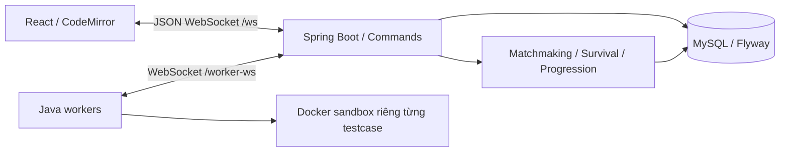

# CodeGrade Network 6.0.0

Ứng dụng luyện tập và thi đấu lập trình qua WebSocket. Java 21 / Spring Boot / JDBC, MySQL 8.4 / Flyway, React 18 / Vite / CodeMirror, Java worker và Docker sandbox.

Học phần Lập trình mạng, năm học 2026–2027. Thông tin nhóm nằm trong [báo cáo Word gốc](report/Bao_cao_CodeGrade_Network.docx). [Phụ lục kỹ thuật v6](report/CodeSurvival-v6.md) mô tả thay đổi, giao thức, kiểm thử và nội dung để nhóm đồng bộ vào báo cáo nộp chính thức.

## Chức năng

Giao diện đã được tổ chức lại thành Question Studio năm bước và đấu trường Code Survival với HUD, chọn mode, tìm trận và kết quả theo dữ liệu server. Xem [bàn giao UI/UX](report/UI-Redesign.md) để biết các file thay đổi, kiểm thử và giới hạn xác minh hiển thị. Kết quả mới nằm trong [redesign-verification.json](statics/results/redesign-verification.json) và [redesign-ui-live.json](statics/results/redesign-ui-live.json); các báo cáo v6 bên dưới là mốc trước redesign.

Practice cá nhân, Contest, ngân hàng đề, chấm bài và lịch sử, bảng xếp hạng, hồ sơ, bookmark, bình luận và quản trị ADMIN / AUTHOR / CODER được giữ. Một engine Code Survival dùng chung cho ba mode; không tạo game PvP riêng.

| Survival | Cách vào | Số người bắt đầu | EXP | Rating Survival |
|---|---|---:|---|---|
| PRACTICE — Giao lưu | Host tạo phòng, mời bằng mã | 2–10 | Không cộng | Không đổi |
| NORMAL — Đấu thường | Server ghép queue | Đúng 5 | Theo thứ hạng | Không đổi |
| RANKED — Đấu Rank | Server ghép theo rating | Đúng 5 | Theo thứ hạng | Elo năm người |

Host Practice cấu hình tên, sức chứa 2–10, độ khó, thời gian vòng/chung kết 30–3600 giây. Normal/Ranked không nhận tạo/cấu hình/bắt đầu phòng thủ công và không cho người ngoài vào bằng mã.

## Kiến trúc mạng



Client gửi `{v:1,type,requestId,payload}`; server trả ACK sau commit và ghi EVENT bền vững để phát lại khi reconnect. `commands(user_id,request_id)` gắn requestId với fingerprint/phản hồi. Retry giữ nguyên requestId và payload. Khóa SQL `system_lock FOR UPDATE` tuần tự hóa admission, matchmaking, cutoff và settlement trên các tiến trình dùng chung database. Worker không giữ khóa trong lúc chạy code.

Giữ `received_at`, `admission_order`, snapshot đề/source, lease và lịch sử submission. Không tạo Receipt/Certificate mới, không trả chúng trong ACK/EVENT/snapshot. Replay cũ được lọc proof; `RECEIPT_GET` bị từ chối kể cả khi có command response cũ. Bảng legacy vẫn còn để bảo toàn dữ liệu.

### Survival engine

`LOBBY → COUNTDOWN → ROUND_ACTIVE → ROUND_GRADING → ROUND_RESULT → … → FINISHED`.

Khóa toàn bộ bank/phiên bản trước COUNTDOWN; chỉ chọn đề đã có validatedVersion khớp version. Mỗi người tối đa hai lượt chính thức/vòng. Đóng nhận bài khi hết giờ hoặc mọi người đã nộp; chờ verdict các bài hợp lệ. Người không AC bị loại; trong nhóm AC giữ tối đa `max(2,floor(0.7*n))`, riêng hai người giữ một. Hòa ở ranh giới dùng TIE_BREAK, giữ nguyên suất đã chắc chắn. Lỗi hạ tầng dùng RESCUE; không ai AC/hết đề cứu hộ thì UNRESOLVED, không thưởng/rating.

Chung kết có thể chốt sớm khi AC được xác nhận, nhưng phải chờ bài đến sớm hơn còn QUEUED/RUNNING. Worker chấm nhanh hơn không quyết định người thắng. Mất kết nối có 90 giây để quay lại; sau đó tính forfeit. Bỏ cuộc vẫn nằm trong roster/kết quả, rời sau khi bị loại không được nâng hạng. Phòng và lịch sử không bị xóa khi thành viên rời.

### Matchmaking

`WAITING → MATCH_FOUND → ACCEPTED → STARTED`, hoặc CANCELLED / EXPIRED / COMPLETED.

Queue bền vững trong SQL, khóa chính user_id ngăn một tài khoản có hai suất. Không đồng thời chờ/trong hai trận. Cần đủ năm người khác nhau và năm xác nhận mới đếm ngược. Hết hạn nhận trận (mặc định 20 giây), từ chối hoặc thiếu lease sẵn sàng trước vòng đầu: đóng phòng chưa bắt đầu, đưa người còn hợp lệ về queue và giữ thời điểm chờ cũ. Không dùng bot.

Normal ưu tiên Level gần nhau trong 10 giây đầu khi có nhiều lựa chọn, sau đó ưu tiên FIFO. Có đủ năm hợp lệ thì ghép ngay. Sáu người tạo một phòng và một người chờ; 10/15 người tạo 2/3 phòng.

| Ranked: thời gian chờ của người được xét trước | max(rating) − min(rating) của cả năm |
|---|---:|
| 0–<10 giây | 150 |
| 10–<20 giây | 250 |
| 20–<30 giây | 350 |
| Từ 30 giây | 400 |

Không so riêng từng người với một anchor rồi bỏ qua toàn nhóm; không tăng vô hạn sau 30 giây. Ưu tiên người chờ lâu, nhưng không để rating cô lập chặn nhóm khác hợp lệ. Queue heartbeat/lease 90 giây, lease sẵn sàng trước vòng đầu 30 giây. Reconnect đọc trạng thái chính thức, không dùng MATCH_FOUND cũ để tạo trận mới.

### Elo, EXP, Level

Survival rating khởi tạo 1000 trong `progression`, tách khỏi `users.elo` của Contest.

```text
E(i,j) = 1 / (1 + 10^((Rj − Ri)/400))
S = 1 nếu xếp trên; 0.5 nếu đồng hạng; 0 nếu xếp dưới
DeltaRi = round((K/4) × SUM_j≠i(S(i,j) − E(i,j)))
K mặc định = 32
```

Dùng snapshot rating trước trận của cả năm, chỉ settlement sau FINISHED trong một transaction. Năm rating 1000 với hạng 1,2,3,4,5 cho delta Elo cơ bản `+16,+8,0,−8,−16`; sau hỗ trợ Đồng ×3 cho phần điểm tăng, delta thực tế là `+48,+24,0,−8,−16`. Thắng đối thủ rating thấp nhận ít hơn thắng đối thủ mạnh. Thứ hạng dựa mốc bị loại; các người cùng nhóm bị loại đồng hạng, không phá hòa bằng thời gian worker.

Bậc Đồng / Bạc / Vàng / Bạch Kim / Kim Cương / Cao Thủ có ngưỡng 1100 / 1300 / 1500 / 1700 / 1900.

| Nguồn EXP | Thưởng |
|---|---|
| Luyện tập cá nhân, kể cả AC lần đầu | Không cộng |
| Survival Practice — Giao lưu | Không cộng |
| Normal/Ranked, hạng 1–5 không hòa | 100 / 80 / 60 / 40 / 20 |

Người đồng hạng nhận EXP theo vị trí thấp nhất của nhóm hòa. Ví dụ: một người nhất nhận 100 EXP, bốn người còn lại cùng hạng nhận 20 EXP mỗi người; hai người cùng hạng 2 nhận 60 EXP mỗi người, hai người cùng hạng 4 nhận 20 EXP mỗi người. Unique event key và khóa `(room_id,user_id)` chống thưởng/settlement trùng. Luyện tập cá nhân và giao lưu không cộng EXP; chỉ Normal/Ranked thưởng EXP. Quy tắc mới áp dụng cho kết quả mới, không tính lại phần thưởng lịch sử. Chạy thử, trận hủy và UNRESOLVED không thưởng. `Level = 1 + floor(sqrt(EXP/100))`; huy hiệu ở Level 2/5/10, khung silver/gold ở 5/10. Không tạo lợi thế về thời gian, lượt nộp hoặc quyền xem test.

## Editor thi đấu

Contest lưu nháp cục bộ riêng theo tài khoản/contest/bài; cả ba mode Survival lưu riêng theo tài khoản/phòng/vòng/bài. Không đọc hoặc ghi nháp luyện tập cá nhân vào editor thi đấu. Submit thành công, bị từ chối và chạy thử đều giữ nguyên code; ACK muộn không cập nhật editor của vòng khác. Có thể tải lại trang để phục hồi nháp trên cùng trình duyệt. Khi Survival đóng vòng để chấm hoặc trả kết quả, editor vẫn hiển thị ở chế độ chỉ đọc để xem/sao chép; vòng mới dùng nháp riêng. Mất ACK: retry cùng requestId và payload để lấy kết quả đã commit. Practice cá nhân tiếp tục lưu nháp cục bộ và server; server không lưu nháp thi đấu và vẫn xóa nháp legacy tương ứng khi nhận SUBMIT chính thức.

Bảng kết quả trực tiếp của Survival lấy từ snapshot server, hiển thị người chơi/khán giả, trạng thái nộp/chấm, số lượt, điểm và thời gian hiệu lực. Thứ hạng còn tạm thời khi vòng chưa chốt; vòng bị hủy không hiển thị hạng như kết quả chính thức. Bảng không trả source của đối thủ hoặc test ẩn.

## Ngân hàng đề của phiên bản 6.0.0

| Chủ đề | Tham chiếu C++11 | Tham chiếu Python 3.11 | Tổng |
|---|---:|---:|---:|
| Arithmetic | 20 | 34 | 54 |
| Arrays | 20 | 34 | 54 |
| Strings | 20 | 33 | 53 |
| Number Theory | 20 | 33 | 53 |
| Sequences | 20 | 33 | 53 |
| Graphs | 20 | 33 | 53 |
| **Tổng** | **120** | **200** | **320** |

[dataset.json](backend/src/main/resources/dataset.json) là nguồn dữ liệu duy nhất của phiên bản 6.0.0: 320 bài, mỗi bài 5 testcase, tổng 1.600 testcase; một ví dụ công khai và bốn test ẩn. Mã bài được giữ ổn định để bảo toàn liên kết lời giải và dữ liệu người dùng.

200 bài có phát biểu/contract/ví dụ tiếng Việt, độ khó 1–6, CPU/RAM và lời giải Python 3.11. [solutions/README.md](solutions/README.md) liệt kê đủ 120 lời giải C++11 và 200 lời giải Python cùng phương pháp/độ phức tạp. C++11/17/20 và Python 3.11 đều tiếp tục là ngôn ngữ nộp bài. Một số bài khó có giới hạn nhỏ để dùng vét cạn tham chiếu.

Bootstrap chỉ đọc dataset.json, thêm bài chưa có khi bật DEMO_DATA và đưa đáp án tham chiếu vào queue VALIDATE. Bài đã tồn tại, dữ liệu người dùng và snapshot được giữ nguyên. Schema được tạo bằng một migration duy nhất: `V1__initial_schema.sql`, dùng cho database mới. Database đã áp dụng bộ V1–V6 cũ cần đối chiếu schema và chuyển tiếp lịch sử Flyway riêng trước khi chạy bản này; source không tự reset database, sửa lịch sử hoặc xóa volume.

Database tạo mới dùng toàn bộ 320 bài / 1.600 testcase. Database đã có dữ liệu giữ nguyên nội dung đang lưu; thay đổi source không tự chuyển đổi các bài cũ. Tạo lại dữ liệu từ đầu chỉ áp dụng với database mới, tách biệt dữ liệu đang sử dụng.

## Chạy Docker Compose

Cần Docker Desktop/Engine hoạt động. Môi trường kiểm thử có 12 CPU, 8 GiB Docker VM, bốn workers.

```powershell
# Chỉ tạo .env khi chưa có; giữ bí mật mật khẩu được sinh.
py -3.11 scripts/init_env.py --demo
docker compose up -d --build --scale worker=4
docker compose ps
docker compose logs --tail 50 server worker
```

Mở `http://localhost:8080`. `admin` dùng ADMIN_PASSWORD; `author`, `coder01`…`coder10` dùng DEMO_PASSWORD khi DEMO_DATA=true. Chờ worker xác thực bank lần đầu. Dừng giữ dữ liệu bằng `docker compose stop`; chạy lại `docker compose up -d`. Không chạy `down -v` hoặc tự đổi mật khẩu của volume cũ trong .env.

[.env.example](.env.example) liệt kê DB_PASSWORD, MYSQL_ROOT_PASSWORD, ADMIN_PASSWORD (10–72 ký tự), WORKER_TOKEN (≥32 ký tự), PORT, APP_ORIGINS và cấu hình:

```dotenv
SURVIVAL_RATING_RANGES=150,250,350,400
SURVIVAL_RANK_THRESHOLDS=1100,1300,1500,1700,1900
SURVIVAL_K_FACTOR=32
SURVIVAL_RANK_GAIN_MULTIPLIERS=3,2,1.5,1,1,1
SURVIVAL_ACCEPT_SECONDS=20
```

Rank Survival mặc định: Đồng dưới 1100; Bạc 1100–1299; Vàng 1300–1499; Bạch Kim 1500–1699; Kim Cương 1700–1899; Cao Thủ từ 1900. Điểm tăng Elo cơ bản được nhân theo rank đầu trận: Đồng ×3, Bạc ×2, Vàng ×1,5, các rank còn lại ×1. Điểm trừ giữ nguyên, thay đổi bằng 0 vẫn bằng 0; chỉ Ranked thay đổi rating. Ví dụ với K=32, người thắng một trận 5 người cùng rating được +48 ở Đồng, +32 ở Bạc, +24 ở Vàng, +16 từ Bạch Kim. Đây là mức hỗ trợ thăng hạng nên tổng thay đổi rating của trận không bắt buộc bằng 0. API `PROGRESSION_GET` trả về các mốc cấu hình, hệ số và số rating còn thiếu; giao diện không tự định nghĩa lại ngưỡng rank. Thay đổi áp dụng cho các trận chưa chốt kết quả; lịch sử đã thưởng không được tính lại.

Ngoài Docker: Java 21, Maven 3.9, Node ≥22.12; cấu hình DB_URL/DB_USER/DB_PASSWORD trong environment, `mvn spring-boot:run` tại backend, `npx vite` tại frontend. Proxy Vite nằm trong frontend/vite.config.js. Worker cần Docker và `WORKER_URL`, `WORKER_TOKEN`, `SANDBOX_IMAGE=codegrade-sandbox:5`; không có fallback chạy source người dùng trên host.

## Kiểm thử

```powershell
cd frontend
npm ci
npm test
npm run build
cd ../backend
mvn test
cd ..
# Cần Python 3.11 và g++ đủ c++11/17/20, hoặc image tools-test.
py -3.11 -X utf8 scripts/verify_dataset.py
py -3.11 -m unittest discover -s scripts/tests -v
```

Các script `survival_smoke.py`, `judge_smoke.py`, `restart_smoke.py`, `benchmark_ws.py` dùng cho demo trong project Compose/file env riêng để không thêm trận thử vào lịch sử cá nhân. Xem tham số `--help`. Target tools-test trong Dockerfile có Python 3.11/g++/websockets; bind source vào /workspace và nối network của project kiểm thử. Script UI:

```powershell
$env:CG_ENV_FILE='đường dẫn file env kiểm thử'
$env:CG_UI_URL='http://localhost:18080'
node frontend/tests/survival-ui.cjs
```

Kiểm tra sau khi hợp nhất phiên bản ngày 30/10/2026: backend 96/96 test; frontend 122/122 test và Vite build đạt; 3/3 test đóng gói đạt. Script tạo dữ liệu chạy trong thư mục tạm tái tạo đúng nguyên dataset 320 bài / 1.600 testcase. Verifier chạy 1.000 testcase Python, 125 kiểm tra độc lập và đối chiếu 600 testcase C++ bằng Python oracle. Chưa chạy lại binary C++ hoặc smoke test Docker trong lần này vì máy chưa có g++ và Docker Engine chưa hoạt động.

Kết quả lịch sử ngày 29/10/2026, trước lần hợp nhất phiên bản:

| Kiểm tra | Kết quả | Bằng chứng |
|---|---|---|
| Backend | 91/91, không failure/error/skip | [verification-v6.json](statics/results/verification-v6.json) |
| Frontend | 68/68; Vite build đạt | [verification-v6.json](statics/results/verification-v6.json) |
| UI/server thật | 7 kiểm tra DOM đạt | [survival-v6-ui.json](statics/results/survival-v6-ui.json) |
| Tham chiếu | 1.000 lượt Python, 1.800 lượt C++, 125 kiểm tra độc lập | [dataset-v6-verification.json](statics/results/dataset-v6-verification.json) |
| Ba mode thật | Practice 2 không EXP; Normal/Ranked: 100 + 4×20 EXP | [exp-policy-smoke.json](statics/results/exp-policy-smoke.json) |
| Docker judge | AC bốn ngôn ngữ; WA/CE/TLE | [judge-v6-smoke.json](statics/results/judge-v6-smoke.json) |
| Restart thật | Queue/session/joinedAt và UUID/mã/version giữ nguyên | [restart-v6.json](statics/results/restart-v6.json) |
| Fairness | 10.000 mô phỏng: baseline sai cutoff 6.151, proposed 0 | [fairness-v6.json](statics/results/fairness-v6.json) |
| PING RTT | 1/10/30 client, tổng 820 ACK | [network-v6.json](statics/results/network-v6.json) |

PING p95 lần này: 14,362 / 18,084 / 200,664 ms. Đây không phải thông lượng judge hay tải matchmaking. Fairness là mô phỏng, không đo mạng. Baseline frontend đạt 70 test sau cài dependency; một lần backend đạt 65/66 với lỗi nạp resource dataset, bộ cuối 91/91 đạt. Báo cáo v5.5 trong thư mục results giữ như lịch sử, không dùng thay kết quả v6.

