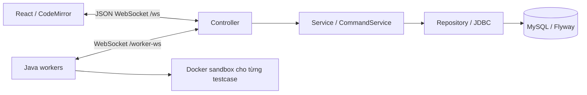

# CodeGrade Network

Ứng dụng luyện tập và thi đấu lập trình qua WebSocket, gồm ngân hàng đề, chấm bài bằng Docker, Contest và Code Survival. Backend quyết định thời điểm nhận bài, trạng thái trận, kết quả và phần thưởng; trình duyệt nhận ACK/EVENT để cập nhật giao diện.

Dự án học phần Lập trình mạng, năm học 2026–2027. Thông tin nhóm nằm trong [báo cáo Word](report/Bao_cao_CodeGrade_Network.docx); [phụ lục v6](report/CodeSurvival-v6.md) ghi lại thiết kế và các lần kiểm tra trước. README này mô tả mã nguồn hiện tại.

## Chức năng và phân quyền

| Phần | Chức năng hiện có |
|---|---|
| Tài khoản | Đăng ký CODER, đăng nhập, sửa hồ sơ, đổi mật khẩu; đổi mật khẩu thu hồi các phiên đăng nhập |
| Luyện tập | Tìm theo tên/mã `CG-xxxx`, lọc chủ đề/độ khó/trạng thái giải/bookmark, soạn C++ hoặc Python, chạy ví dụ, Precheck và nộp chính thức |
| Bài nộp | Tiến độ từng testcase, điểm/verdict, xem lại source và phản hồi được phép; lịch sử phân trang từ server, 10/20/50 bài mỗi trang |
| Xếp hạng | Số bài AC, EXP, Survival rating, số trận Normal/Ranked và Contest Elo; xếp hạng từng bài theo thời gian chạy, độ dài source rồi thời điểm nhận bài |
| Contest | Tạo lịch thi với 1–100 đề, đăng ký trực tiếp hoặc chờ duyệt, phòng thi riêng, bảng điểm và chốt Elo khi bật rated |
| Code Survival | Giao lưu bằng phòng riêng, ghép trận Normal/Ranked, xác nhận trận, loại dần qua các vòng, bảng điểm trực tiếp và lịch sử kết quả |
| Question Studio | Năm phần cấu hình, xem trước, nhập/xuất JSON, nháp trên thiết bị, kiểm tra lời giải mẫu qua worker |
| Cộng đồng/quản trị | Bookmark, bình luận theo bài, thông báo, quản lý danh mục, tài khoản/quyền và nhật ký audit |

`CODER` tham gia thi đấu và được tính xếp hạng. `AUTHOR` tạo đề, sửa đề của mình, quản lý danh mục và tổ chức Contest. `ADMIN` quản lý mọi đề, tài khoản, thông báo và audit. Đăng ký mới luôn tạo CODER; ADMIN có thể đổi quyền hoặc khóa tài khoản khác.

Giao diện hỗ trợ VI/EN, desktop/mobile, dùng header ngang, shadcn/ui và Tailwind CSS. Trang thông thường có cột tiện ích theo kích thước màn hình; trang soạn đề, giải bài, sảnh và phòng Survival dùng bố cục tập trung. Xem [README frontend](frontend/README.md).

## Công nghệ và cấu trúc

| Thành phần | Công nghệ trong source |
|---|---|
| Backend | Java 21, Spring Boot 3.5.7, Spring WebSocket, Spring JDBC, BCrypt, RE2/J |
| Database | MySQL 8.4 trong Compose, Flyway, một migration `V1__initial_schema.sql` |
| Frontend | React 19, Vite 7, Tailwind CSS 4, shadcn/ui, Radix, Lucide, Sonner, CodeMirror 6 |
| Worker | Java 21, `java.net.http.WebSocket`, Docker CLI; không kết nối trực tiếp MySQL |
| Sandbox | Python 3.11 và g++, container Linux mới cho từng testcase |
| Kiểm thử | JUnit/Spring Boot Test/H2, Node test runner/JSDOM, Playwright, Python unittest và smoke qua WebSocket |

```text
Source/
├── backend/             # Controller, service, repository, model, worker Java
│   └── src/main/resources/
│       ├── application.yml
│       ├── dataset.json
│       └── db/migration/V1__initial_schema.sql
├── frontend/            # React, UI, thư viện giao thức và kiểm thử trình duyệt
├── worker/              # Dockerfile sandbox và watchdog sandbox.py
├── scripts/             # Khởi tạo môi trường, sinh/kiểm tra bank, smoke và benchmark
├── solutions/           # 120 lời giải C++11, 200 lời giải Python, index.json
├── report/              # Báo cáo và phụ lục
├── statics/results/     # Kết quả kiểm tra, được bỏ qua trong Git
├── compose.yaml         # mysql, server, worker, sandbox
├── compose.test.yaml    # frontend-test, backend-test, tools-test
├── Dockerfile           # Các stage build, chạy và kiểm thử
└── .env.example         # Cấu hình mẫu
```

## Kiến trúc và giao thức



Backend theo lớp `controller → service → repository → database`; model chứa luật kiểm tra đề và xếp hạng, độc lập với Spring/JDBC. [README backend](backend/README.md) mô tả transaction, schema và truy vấn.

HTTP cung cấp `/api/health`, `/api/meta` và frontend tĩnh. Nghiệp vụ dùng JSON WebSocket v1 tại `/ws`, không dùng STOMP/SockJS. Ví dụ yêu cầu:

```json
{"v":1,"type":"PING","requestId":"demo-1","payload":{}}
```

ACK có `v`, `type: "ACK"`, `requestId`, `command`, `ok`, `serverTime` và `data` khi thành công hoặc `error: {code, message}` khi lỗi. EVENT có `seq`, `event`, `data`, `serverTime`. Thời gian là timestamp milliseconds. Client gọi `LOGIN`/`REGISTER`, nhận token rồi `AUTH` trước khi dùng command nghiệp vụ. Reconnect gửi `AUTH` kèm `lastSeq`, sau đó `SYNC` lấy trạng thái chính thức. Token/cursor lưu trong `sessionStorage`; client PING mỗi 15 giây, reconnect với khoảng chờ tăng từ 0,5 đến 10 giây.

Command ghi lưu theo `(user_id, request_id)` cùng fingerprint và response. Khi mất ACK, retry **cùng requestId, type và payload** để nhận lại kết quả đã commit; dùng lại ID cho nội dung khác bị từ chối. Command đọc dùng transaction đọc `REPEATABLE_READ`; ghi nghiệp vụ thi đấu dùng khóa hàng `competition`, đăng ký dùng khóa `identity`. Worker chạy code bên ngoài transaction database. Không còn API Receipt/Certificate; `RECEIPT_GET` bị từ chối.

### Luồng chấm bài

1. Server kiểm tra quyền, ngôn ngữ, hạn nộp, số lượt và queue; lưu source, snapshot đề/test, `received_at`, `admission_order` trước ACK.
2. Worker xác thực tại `/worker-ws`, nhận job bằng `CLAIM`; lease 30 giây, heartbeat mỗi 5 giây, báo `PROGRESS` trước mỗi test.
3. Mỗi testcase được biên dịch/chạy trong container riêng: không network, filesystem chỉ đọc, user không đặc quyền, giới hạn CPU/RAM/PID/output và vùng ghi tạm `tmpfs`.
4. Worker trả stdout và trạng thái thực thi. Expected output ở lại server; server so sánh, tính điểm và phát EVENT. Kết quả lease cũ bị bỏ qua; lỗi hạ tầng được thử lại tối đa 3 lượt rồi thành `SE`.

Hỗ trợ `CPP11`, `CPP17`, `CPP20`, `PY311`; bốn loại đề `cpp_program`, `cpp_function`, `python3_program`, `python3`. Grader chạy được: `EqualityGrader`, `NearEqualityGrader`, `RegexGrader`. Verdict cuối: `AC`, `WA`, `CE`, `RE`, `TLE`, `MLE`, `OLE`, `SE`; trước đó là `QUEUED`/`RUNNING`.

Source tối đa 65.536 ký tự; mỗi tài khoản tối đa 4 bài đang chờ/chấm, toàn queue mặc định 500. CPU thực thi mỗi test 1–10 giây, RAM 64–512 MB, tổng stdout/stderr tối đa 65.536 byte. Worker bắt buộc có Docker và sandbox image, không chuyển sang chạy bài trên host khi Docker lỗi.

## Code Survival, Contest và bản nháp

| Survival | Cách vào | Số người bắt đầu | EXP | Survival rating |
|---|---|---:|---|---|
| `PRACTICE` — Giao lưu | Host tạo phòng, mời bằng mã | 2–10 | Không cộng | Không đổi |
| `NORMAL` — Đấu thường | Server ghép queue | Đúng 5 | Theo thứ hạng | Không đổi |
| `RANKED` — Đấu Rank | Server ghép theo rating | Đúng 5 | Theo thứ hạng | Elo năm người |

Host Giao lưu chỉnh tên, sức chứa, tập độ khó 1–6 và thời gian vòng/chung kết 30–3.600 giây tại lobby; mặc định 120/150 giây. Normal/Ranked dùng cấu hình server: 5 người, độ khó 1/2/3, vòng 120 giây, chung kết 150 giây. Phòng ghép không nhận người ngoài bằng mã hoặc cho host bắt đầu thủ công.

### Vòng đấu

`LOBBY → COUNTDOWN → ROUND_ACTIVE → ROUND_GRADING → ROUND_RESULT → … → FINISHED`.

Bank và phiên bản đề đóng băng trước COUNTDOWN 10 giây. Chỉ chọn đề công bố, bật Survival, có test ẩn và lời giải mẫu đã AC đúng phiên bản; cần ít nhất số vòng chính dự kiến cộng một đề dự phòng. Mỗi người tối đa hai lượt chính thức/vòng, không tính bài `SE`. Đóng nhận bài khi hết giờ hoặc mọi thí sinh còn thi đấu đã nộp ít nhất một bài; chờ các bài đã nhận chấm xong.

AC xếp trước, thời gian hiệu lực bằng `received_at − startedAt + 10 giây × số lần sai trước AC`. Người không AC bị loại; số người giữ tối đa là `max(2, floor(0.7 × n))`, riêng hai người giữ một. Hòa tại ranh giới vào `TIE_BREAK`, giữ nguyên suất đã chắc chắn. Chung kết có thể chốt sớm khi có AC nhưng phải chờ các bài nhận cùng lúc hoặc sớm hơn còn pending; thời điểm worker hoàn tất không được dùng làm mốc nhận bài.

Vòng lỗi hạ tầng hoặc bị ADMIN hủy chuyển sang `RESCUE`. Không ai AC hoặc hết đề còn dùng được thì `UNRESOLVED`, không thưởng/rating. Mất presence 90 giây tính bỏ cuộc; roster và lịch sử vẫn được giữ. Ngoài `FINISHED`, phòng có thể kết thúc ở `CLOSED` hoặc `UNRESOLVED`.

### Ghép trận

Queue lưu trong SQL: `WAITING → MATCH_FOUND → ACCEPTED → STARTED`, có thể chuyển `CANCELLED`, `EXPIRED`, `COMPLETED`. Mỗi tài khoản chỉ có một suất queue và không được đồng thời chơi ở hai phòng. Đủ năm người khác nhau và năm xác nhận mới bắt đầu countdown; thời gian nhận trận mặc định 20 giây.

Normal ưu tiên Level gần nhau trong 10 giây đầu, sau đó FIFO. Ranked áp dụng chênh lệch `max(rating) − min(rating)` của cả nhóm:

| Thời gian chờ của người đang được xét | Chênh lệch tối đa mặc định |
|---|---:|
| Dưới 10 giây | 150 |
| 10–<20 giây | 250 |
| 20–<30 giây | 350 |
| Từ 30 giây | 400 |

Queue lease 90 giây; lease sẵn sàng trước vòng đầu 30 giây. Khi trận bị hủy trước khi bắt đầu, người còn hợp lệ trở lại queue và giữ thời điểm chờ cũ. Không dùng bot bù người.

### Rating, EXP và Level

Survival rating ban đầu 1000 trong `progression`, tách khỏi Contest Elo trong `users.elo`. Ranked dùng rating đầu trận và thứ hạng cuối của cả năm:

```text
E(i,j) = 1 / (1 + 10^((Rj − Ri)/400))
S(i,j) = 1 nếu xếp trên; 0.5 nếu đồng hạng; 0 nếu xếp dưới
delta cơ bản = round((K/4) × SUM_j≠i(S(i,j) − E(i,j))), K mặc định 32
```

| Bậc | Rating mặc định | Hệ số cho delta dương |
|---|---|---:|
| Đồng | Dưới 1100 | ×3 |
| Bạc | 1100–1299 | ×2 |
| Vàng | 1300–1499 | ×1,5 |
| Bạch Kim | 1500–1699 | ×1 |
| Kim Cương | 1700–1899 | ×1 |
| Cao Thủ | Từ 1900 | ×1 |

Hệ số dùng bậc đầu trận, không nhân điểm trừ. Năm người cùng rating 1000 có hạng 1–5 nhận delta thực tế `+48, +24, 0, −8, −16`. Server trả ngưỡng và tiến độ qua `PROGRESSION_GET`; hình huy hiệu trên UI không tạo thêm bậc rating ngoài cấu hình này.

Chỉ Normal/Ranked hoàn tất thưởng EXP: hạng 1–5 nhận `100/80/60/40/20`; nhóm hòa nhận theo vị trí thấp nhất của nhóm. Luyện tập cá nhân, Survival Giao lưu, chạy thử, trận hủy và UNRESOLVED không cộng EXP. `Level = 1 + floor(sqrt(EXP/100))`; huy hiệu ở Level 2/5/10, khung avatar silver/gold ở 5/10. Settlement và reward có khóa duy nhất chống cộng trùng.

Contest xếp theo tổng điểm tốt nhất mỗi bài rồi penalty tăng dần. Penalty bài AC là số giây từ lúc bắt đầu tới lúc nhận bài AC, cộng 600 giây mỗi bài sai trước đó. Khi kết thúc, server chờ hết bài pending mới chốt standings; chỉ Contest bật rated và có hơn một CODER mới cập nhật Contest Elo.

### Bản nháp

Practice cá nhân lưu theo tài khoản/bài ở `localStorage` và gửi server sau 1,2 giây ngừng sửa. Contest lưu cục bộ theo tài khoản/contest/bài; Survival theo tài khoản/phòng/vòng/bài. Nháp thi đấu không gửi server. Submit/chạy thử không xóa code; ACK muộn không thay editor của vòng mới. Sau khi đóng vòng, editor Survival vẫn cho xem/sao chép ở chế độ chỉ đọc.

## Ngân hàng đề

[dataset.json](backend/src/main/resources/dataset.json) là nguồn seed, có **320 bài / 1.600 testcase**. Mỗi bài có 5 test, một ví dụ công khai và bốn test ẩn; tất cả cho nộp C++11/17/20 hoặc Python 3.11.

| Chủ đề | Lời giải C++11 | Lời giải Python 3.11 | Tổng bài |
|---|---:|---:|---:|
| Arithmetic | 20 | 34 | 54 |
| Arrays | 20 | 34 | 54 |
| Strings | 20 | 33 | 53 |
| NumberTheory | 20 | 33 | 53 |
| Sequences | 20 | 33 | 53 |
| Graphs | 20 | 33 | 53 |
| **Tổng** | **120** | **200** | **320** |

[Danh mục lời giải](solutions/README.md) và [index.json](solutions/index.json) ghi phương pháp/độ phức tạp. Một số bài khó dùng giới hạn nhỏ cho lời giải tham chiếu vét cạn. `scripts/generate_dataset.py` tái tạo dataset, lời giải và README của `solutions`; script này ghi file, không phải bước cần chạy để khởi động ứng dụng.

Khi `DEMO_DATA=true`, SeedService thêm tài khoản mẫu, danh mục và bài còn thiếu theo `general.idNumber`, rồi đưa lời giải tham chiếu vào queue `VALIDATE` thật. Bài chỉ đủ điều kiện Survival sau khi worker xác thực đúng phiên bản. Khởi động lại không ghi đè bài đã lưu và không tự đổi mật khẩu tài khoản có sẵn.

## Cài đặt và chạy bằng Docker Compose

Cần Docker Desktop/Engine chạy Linux containers, Docker Compose v2; Python 3.11 nếu dùng script tạo `.env`. Java, Node và g++ được cài trong image build, không cần cài trên host cho cách chạy này. Thực hiện tại thư mục `Source`:

```powershell
py -3.11 scripts/init_env.py --demo
docker compose up -d --build --scale worker=2
docker compose ps
docker compose logs --tail 50 server worker
```

Script chỉ tạo `.env` khi chưa có, in mật khẩu vừa sinh và giữ nguyên file hiện hữu. Nếu dùng `.env` có sẵn, kiểm tra `DEMO_DATA=true` và `DEMO_PASSWORD` để bật bank mẫu. Có thể tự tạo `.env` từ [.env.example](.env.example) nếu không dùng Python.

Mở **http://localhost:8080**. `admin` dùng `ADMIN_PASSWORD`; `author`, `coder01`…`coder10` dùng `DEMO_PASSWORD` khi bật demo. Chờ worker xác thực bank trước khi tạo trận Survival. Compose chỉ publish server trên `127.0.0.1`; MySQL chạy trong network nội bộ. Cổng host khác được chọn bằng `PORT`.

```powershell
# Dừng và chạy lại, giữ database trong volume mysql_data.
docker compose stop
docker compose up -d --scale worker=2
```

### Cấu hình

| Biến | Ý nghĩa/mặc định |
|---|---|
| `DB_PASSWORD`, `MYSQL_ROOT_PASSWORD` | Mật khẩu MySQL; bắt buộc trong Compose |
| `ADMIN_PASSWORD` | Mật khẩu tạo admin lúc database chưa có tài khoản; 10–72 ký tự |
| `WORKER_TOKEN` | Bí mật dùng chung server/worker, ít nhất 32 ký tự |
| `DEMO_DATA`, `DEMO_PASSWORD` | Mặc định `false`; khi bật cần mật khẩu demo 10–72 ký tự |
| `PORT` | Cổng host Compose, mặc định 8080 |
| `APP_ORIGINS` | Danh sách Origin WebSocket, ngăn cách bằng dấu phẩy; Compose mặc định localhost/127.0.0.1 cổng 8080 |
| `SURVIVAL_RATING_RANGES` | `150,250,350,400` cho mốc chờ 0/10/20/30 giây |
| `SURVIVAL_RANK_THRESHOLDS` | `1100,1300,1500,1700,1900` |
| `SURVIVAL_K_FACTOR` | `32` |
| `SURVIVAL_RANK_GAIN_MULTIPLIERS` | `3,2,1.5,1,1,1` |
| `SURVIVAL_ACCEPT_SECONDS` | `20`, cho phép 5–60 giây |

`DB_URL`/`DB_USER` dùng khi chạy backend ngoài Compose. `MAX_QUEUE` là biến backend, mặc định 500; `WORKER_URL`, `WORKER_ID`, `SANDBOX_IMAGE` dùng cho worker. Compose đặt `WORKER_URL=ws://server:8080/worker-ws`, `SANDBOX_IMAGE=codegrade-sandbox:5`; tag `:5` vẫn là tag thực tế của sandbox trong source 6.0.0. Biến chưa được khai báo trong `services.*.environment` cần được truyền thêm vào service nếu muốn đổi qua Compose.

### Database và lỗi thường gặp

Flyway tạo **27 bảng ứng dụng** từ [V1__initial_schema.sql](backend/src/main/resources/db/migration/V1__initial_schema.sql), ngoài bảng lịch sử của Flyway. Lần khởi tạo cần database rỗng; source không có migration nâng cấp từ schema cũ. Dùng database/Compose project riêng nếu cần giữ dữ liệu cũ; xem [README backend](backend/README.md).

- `Access denied for user 'codegrade'`: mật khẩu `.env` có thể khác mật khẩu đã lưu trong volume. Đổi `MYSQL_PASSWORD` không đổi tài khoản của database đã khởi tạo.
- WebSocket bị từ chối khi dùng Vite/cổng khác: thêm đúng Origin vào `APP_ORIGINS` của server và tạo lại container server.
- Bài mãi `QUEUED` hoặc thiếu đề Survival: kiểm tra log worker, token, Docker socket và sandbox image; health `UP` không chứng minh worker đang chấm được.
- `.env` không tự được Spring Boot/worker đọc khi chạy trực tiếp; cần đưa giá trị vào environment của từng terminal.

## Phát triển ngoài Docker

Cần Java 21, Maven 3.9, Node.js ≥22.12, MySQL có database rỗng và Docker cho worker. MySQL trong Compose không publish cổng 3306, nên backend trên host cần MySQL truy cập được từ host hoặc một cấu hình port riêng.

Nạp các cặp `KEY=value` từ file `.env` do script của dự án sinh vào terminal PowerShell tại `Source`:

```powershell
Get-Content .env | ForEach-Object {
    if ($_ -match '^([A-Za-z_][A-Za-z0-9_]*)=(.*)$') {
        [Environment]::SetEnvironmentVariable($matches[1], $matches[2], 'Process')
    }
}
$env:DB_URL='jdbc:mysql://localhost:3306/codegrade?useUnicode=true&characterEncoding=UTF-8&serverTimezone=UTC'
$env:DB_USER='codegrade'
$env:APP_ORIGINS='http://localhost:8080,http://127.0.0.1:8080,http://localhost:5173,http://127.0.0.1:5173'
Set-Location backend
mvn spring-boot:run
```

Database/user tương ứng phải được tạo trên MySQL trước; Flyway tạo bảng khi backend chạy. Mở terminal khác từ `Source` cho frontend:

```powershell
Set-Location frontend
npm ci
npm run dev
```

Mở http://localhost:5173. [vite.config.js](frontend/vite.config.js) proxy `/api` và `/ws` tới backend cổng 8080. Khi đổi cổng backend, cập nhật proxy. Docker build tự đưa frontend vào JAR; `mvn package` riêng không tự build/copy frontend.

Worker dùng cùng JAR, chạy sau khi có sandbox image và environment `WORKER_TOKEN` giống server:

```powershell
# Chạy từ Source, trong terminal đã nạp WORKER_TOKEN.
docker build -f worker/Dockerfile -t codegrade-sandbox:5 .
mvn -f backend/pom.xml -DskipTests package
$env:WORKER_URL='ws://localhost:8080/worker-ws'
$env:SANDBOX_IMAGE='codegrade-sandbox:5'
java -jar backend/target/codegrade-network-6.0.0.jar --worker
```

## Kiểm thử và thực nghiệm

```powershell
# Unit test frontend và production build.
npm --prefix frontend ci
npm --prefix frontend test
npm --prefix frontend run build

# Backend: mặc định H2 MySQL mode, không cần MySQL đang chạy.
mvn -f backend/pom.xml clean verify

# Full cần g++ có c++11/17/20; bỏ C++ binary bằng --python-only.
py -3.11 -X utf8 scripts/verify_dataset.py
```

Playwright cần backend demo, worker và bank đã xác thực; dùng Edge trên Windows nếu tìm thấy, hoặc cài Chromium. Test tạo bài nộp/phòng thật, nên dùng môi trường demo riêng:

```powershell
Set-Location frontend
npx playwright install chromium
$env:CG_UI_URL='http://127.0.0.1:18080'
$env:CG_ENV_FILE='C:/path/to/demo.env'
npm run test:e2e
```

Nếu bỏ `CG_UI_URL`, Playwright tự chạy Vite tại 5173. `CG_ENV_FILE` trỏ file mật khẩu cho test UI; không tự khởi tạo server hoặc cấu hình Compose. Có thể dùng `CG_ADMIN_PASSWORD` và `CG_DEMO_PASSWORD` thay thế.

| Script | Mục đích và điều kiện |
|---|---|
| `scripts/verify_dataset.py` | Chạy 1.000 test Python, 125 đối chiếu độc lập, kiểm tra oracle 600 test C++; full còn chạy 600 test ở mỗi chuẩn C++11/17/20 |
| `scripts/judge_smoke.py` | Worker Docker thật: AC bốn ngôn ngữ và WA/CE/TLE; đọc `.env` ở Source hoặc biến mật khẩu chỉ định |
| `scripts/survival_smoke.py` | Kịch bản Survival/ghép trận; dùng `--url`, `--env-file`, xem `--help` |
| `scripts/restart_smoke.py` | Kiểm tra session/queue/bank qua restart; cần chủ động restart server sau `READY_FOR_RESTART` |
| `scripts/benchmark_ws.py` | Đo PING RTT, p50/p95/max và ACK/giây; không đo throughput chấm bài |
| `FairnessExperimentTest.java` | So sánh xếp hạng theo admission với completion time; ghi JSON khi truyền `-Dexperiment.output=...` |

`compose.test.yaml` cung cấp service kiểm thử độc lập. `tools-test` mặc định benchmark tới `ws://server:8080/ws`, mount `.env` hiện tại, nối network `codegrade-network_default`; cần ứng dụng đang chạy. Đổi tên project/network thì phải chỉnh network tương ứng. Kết quả thực nghiệm lưu ở `statics/results/`, không theo dõi trong Git.

### Kết quả kiểm tra

| Kiểm tra chạy trong lần cập nhật README | Kết quả |
|---|---|
| Frontend `npm test` | **85/85 đạt** sau khi bổ sung mô phỏng IntersectionObserver cho JSDOM, cập nhật test theo bố cục cuộn và thêm kiểm tra observer |
| Frontend `npm run build` | Đạt với Vite 7.3.7 |
| Dataset `verify_dataset.py --python-only` | Đạt: 320 bài/1.600 test, 1.000 lần chạy Python, 125 kiểm tra độc lập và đối chiếu oracle 600 test C++; chưa chạy binary C++ |

Backend, Playwright, Docker judge và benchmark tải chưa được chạy lại trong lần cập nhật này. Các số 82/82 frontend, 105/105 backend, 6/6 trình duyệt và 7/7 judge từng ghi trong tài liệu cũ không đại diện cho source hiện tại. Verifier ghi kết quả tham chiếu vào `statics/results/dataset-v6-verification.json`; chế độ `--python-only` không kiểm chứng binary C++ hoặc worker Docker.

## Đóng góp kỹ thuật và giới hạn

Các cơ chế đã triển khai: nhận bài bền vững trước ACK, retry chống ghi trùng bằng requestId, snapshot phiên bản đề, phát lại event khi reconnect, worker lease có phục hồi, tách sandbox khỏi đối chiếu đáp án, chốt phần thưởng trong transaction. Xếp hạng vòng dùng mốc admission để giảm phụ thuộc tốc độ worker; queue và kết quả trận được giữ trong SQL qua restart. Mã và test tương ứng nằm trong `CommandService`, `SubmissionService`, `SurvivalService`, `MatchmakingService`, `ProgressionService` và bộ kiểm thử backend.

Giới hạn hiện tại:

- Khóa `competition` tuần tự hóa ghi nghiệp vụ; chưa có benchmark mới chứng minh khả năng chịu tải. Controller giới hạn 250 kết nối client và 80 message/10 giây/kết nối.
- Mỗi worker xử lý một job tại một thời điểm; mỗi testcase tạo container và biên dịch lại nên có chi phí khởi tạo.
- Runner nhận source text; Twig/combinator/preprocessor/prototype nâng cao, TemplateGrader và file đính kèm chỉ lưu cấu hình draft, chưa chạy như Moodle CodeRunner đầy đủ.
- Thống kê tổng quan từ `SUBMISSIONS` dùng tối đa 100 bài gần nhất; bảng lịch sử dùng `SUBMISSIONS_PAGE` để xem dữ liệu phân trang đầy đủ.
- Nháp Contest/Survival chỉ ở cùng trình duyệt; đổi thiết bị không khôi phục nháp từ server.

## Tài liệu đối chiếu

- [Backend: kiến trúc, schema và kiểm thử](backend/README.md).
- [Frontend: route, bố cục, editor và kiểm thử](frontend/README.md).
- [Lời giải tham chiếu](solutions/README.md).
- [Compose](compose.yaml), [các stage Docker](Dockerfile), [cấu hình mẫu](.env.example).
- [Yêu cầu học phần và README](INSTRUCTION.md), [phụ lục kỹ thuật v6](report/CodeSurvival-v6.md).
