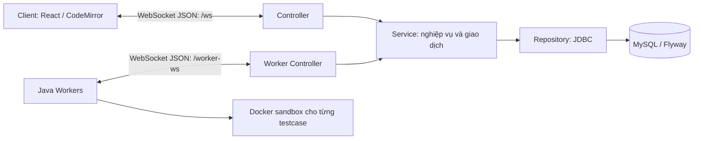
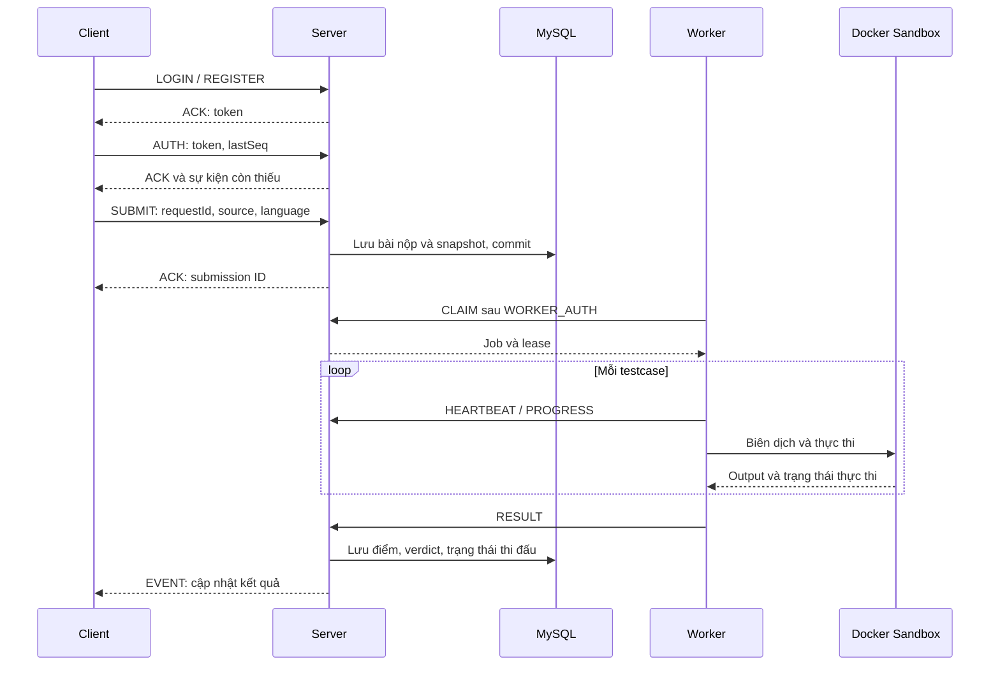
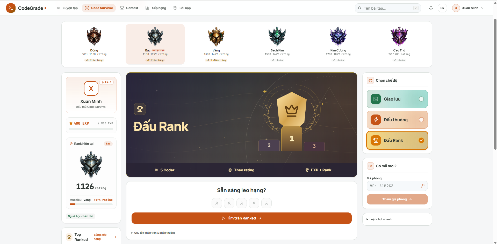

# NETWORK PROGRAMMING – FINAL PROJECT

> **CodeGrade Network — Hệ thống luyện tập và thi đấu lập trình trực tuyến**
>
> Học phần Lập trình mạng · Năm học **2026–2027** · Nhóm lớp **10** · Nhóm **19**


## 1. Project Information — Thông tin dự án

### 1.1. Project Name

**CodeGrade Network**.

### 1.2. Topic

**Xây dựng hệ thống luyện tập và thi đấu lập trình trực tuyến theo mô hình Client–Server.**


### 1.3. Group

| STT | Mã sinh viên | Họ và tên | Email | Phạm vi phụ trách chính | Đóng góp |
| --- | --- | --- | --- | --- | ---: |
| 1 | B23DCCN564 | Phạm Xuân Minh | aptmp58@gmail.com | Tài khoản, phân quyền; Code Survival, ghép trận; hàng đợi chấm bài, Worker và Docker sandbox | 50% |
| 2 | B23DCCN464 | Nguyễn Trung Kiên | ngtrgkien1011@gmail.com | Contest; ngân hàng đề, Question Studio, Workspace; thành tích, xếp hạng và cộng đồng | 50% |
| | | | | **Tổng** | **100%** |

### 1.4. Instructor

**Ngô Văn Quyền**.

## 2. Project Summary — Tóm tắt dự án

### 2.1. Problem

Xây dựng ứng dụng cho phép nhiều người dùng truy cập ngân hàng bài tập, viết mã trên trình duyệt, nộp bài để chấm tự động và tham gia thi đấu. Hệ thống cần quản lý tập trung dữ liệu, tiếp nhận yêu cầu đồng thời và đồng bộ kết quả giữa các Client.

### 2.2. Motivation

Việc kết hợp luyện tập, đánh giá và thi đấu trên cùng nền tảng giúp người học theo dõi tiến bộ và giao lưu với bạn bè. Bài toán cũng tạo điều kiện vận dụng lập trình mạng vào giao tiếp hai chiều, xử lý bất đồng bộ, khôi phục kết nối và bảo đảm tính nhất quán khi nhiều người thao tác cùng lúc.

### 2.3. Objectives

1. Xây dựng nền tảng web có tài khoản, phân quyền, quản lý bài tập, luyện tập và Contest.
2. Thiết kế giao thức WebSocket có xác thực, ACK/EVENT, chống xử lý trùng và hỗ trợ kết nối lại.
3. Tách quá trình chấm bài sang Worker, thực thi mã nguồn trong Docker với giới hạn tài nguyên.
4. Phát triển Code Survival với ghép trận, vòng loại, cập nhật trực tiếp và quyết toán thành tích.
5. Kiểm chứng chức năng, giao thức, hiệu năng chấm bài và ảnh hưởng của độ trễ Worker đến xếp hạng.

### 2.4. Scope

**Trong phạm vi:** ứng dụng web; ba vai trò ADMIN/AUTHOR/CODER; C++11/17/20 và Python 3.11; ngân hàng bài tập; chấm tự động; Contest; Code Survival; xếp hạng, EXP, Rating và tiện ích cộng đồng.

**Ngoài phạm vi hiện tại:** runner cho Java/JavaScript; tương thích đầy đủ Moodle CodeRunner; triển khai dự phòng nhiều Server; đánh giá tải lớn, dài hạn hoặc cam kết hiệu năng qua Internet.

## 3. System Overview — Tổng quan hệ thống

### 3.1. System Description

Client React kết nối Server Spring Boot qua WebSocket. Server kiểm tra quyền, xử lý nghiệp vụ và lưu dữ liệu vào MySQL. Worker Java nhận tác vụ qua kênh riêng, chạy mã nguồn trong Docker rồi trả kết quả thực thi để Server chấm điểm và thông báo cho người dùng. Worker không truy cập trực tiếp cơ sở dữ liệu.

### 3.2. Target Users

| Vai trò | Đối tượng và quyền chính |
| --- | --- |
| `CODER` | Người học: luyện tập, nộp bài, tham gia Contest/Survival, theo dõi thành tích |
| `AUTHOR` | Người tạo đề: tạo và sửa đề thuộc quyền quản lý, quản lý danh mục, tổ chức Contest |
| `ADMIN` | Quản trị viên: quản lý tài khoản, quyền, bài tập, thông báo và nhật ký audit |

Đăng ký mới luôn tạo tài khoản CODER. Server kiểm tra quyền cho từng lệnh nghiệp vụ.

### 3.3. Main Functions

| Chức năng | Mô tả | Trạng thái |
| --- | --- | --- |
| Tài khoản | Đăng ký/đăng nhập, hồ sơ, đổi mật khẩu, thu hồi phiên | Đã triển khai |
| Luyện tập | Tìm kiếm/lọc bài, CodeMirror, chạy ví dụ, Precheck, nộp bài | Đã triển khai |
| Chấm bài | Hàng đợi, tiến độ testcase, điểm, verdict và lịch sử | Đã triển khai |
| Contest | Tạo lịch, chọn đề, đăng ký/duyệt, phòng thi, bảng điểm và Elo | Đã triển khai |
| Code Survival | Giao lưu, Normal, Ranked; vòng loại, đồng hạng, cứu hộ | Đã triển khai |
| Question Studio | Cấu hình đề, testcase, lời giải mẫu, kiểm tra và nhập/xuất JSON | Đã triển khai |
| Thành tích | Số bài AC, EXP/Level, Survival Rating và Contest Elo | Đã triển khai |
| Cộng đồng/quản trị | Bookmark, bình luận, thông báo, tài khoản và audit | Đã triển khai |

## 4. System Architecture — Kiến trúc hệ thống

### 4.1. Architecture Diagram



### 4.2. Components

| Thành phần | Trách nhiệm |
| --- | --- |
| Client | Hiển thị đề, soạn mã, gửi lệnh, nhận ACK/EVENT và phục hồi trạng thái |
| Controller | Quản lý kết nối, kiểm tra thông điệp, xác thực và điều phối lệnh |
| Service | Luật thi đấu, nhận bài, hàng đợi, xếp hạng, thành tích và giao dịch |
| Repository / Database | Truy xuất JDBC; lưu người dùng, bài tập, bài nộp, phòng, lệnh và sự kiện |
| Worker | Xác thực, nhận lease, điều khiển Docker và báo tiến độ/kết quả |
| Sandbox | Biên dịch, chạy chương trình với giới hạn quyền, thời gian, bộ nhớ và output |

Backend tổ chức theo `controller → service → repository → database`;

### 4.3. Data Flow

1. Client gửi lệnh có `requestId`; Server xác thực và kiểm tra dữ liệu/quyền.
2. Khi nhận bài, Server lưu source, snapshot đề/test, `received_at` và `admission_order` trước khi trả ACK.
3. Worker nhận tác vụ từ hàng đợi, thực thi từng testcase trong container riêng.
4. Server đối chiếu output với đáp án, tính điểm/verdict và cập nhật dữ liệu thi đấu.
5. Client nhận EVENT để cập nhật tiến độ, kết quả và bảng xếp hạng.

## 5. Network Communication Design — Thiết kế giao tiếp mạng

### 5.1. Communication Model

```text
Browser Client <-- WebSocket /ws --> Server <-- JDBC --> MySQL
Java Worker    <-- WebSocket /worker-ws --> Server
Java Worker    --> Docker CLI --> Sandbox
```

### 5.2. Protocol

| Kênh | Giao thức và mục đích |
| --- | --- |
| `/ws` | WebSocket trên TCP, JSON v1: nghiệp vụ người dùng, ACK và EVENT |
| `/worker-ws` | WebSocket, JSON v1: `WORKER_AUTH`, `CLAIM`, `HEARTBEAT`, `PROGRESS`, `RESULT` |
| `/api/health`, `/api/meta` | HTTP: tình trạng Server và metadata |
| `/` | HTTP: phục vụ frontend tĩnh khi chạy bản Docker build |


### 5.3. Message Format

Ví dụ lệnh PING và ACK tương ứng; timestamp chỉ minh họa định dạng:

```json
{
  "v": 1,
  "type": "PING",
  "requestId": "demo-1",
  "payload": {}
}
```

```json
{
  "v": 1,
  "type": "ACK",
  "requestId": "demo-1",
  "command": "PING",
  "ok": true,
  "data": { "serverTime": 1793494800000 },
  "serverTime": 1793494800000
}
```

| Loại | Trường dữ liệu |
| --- | --- |
| Command Client | `v`, `type`, `requestId`, `payload` |
| ACK Client thành công | `v`, `type: "ACK"`, `requestId`, `command`, `ok: true`, `data`, `serverTime` |
| ACK Client thất bại | Như ACK, với `ok: false`, `error: {code, message}` thay cho `data` |
| EVENT Client | `v`, `type: "EVENT"`, `seq`, `event`, `data`, `serverTime` |
| Yêu cầu Worker | `v`, `type`, `requestId`, `payload` |
| Phản hồi Worker | `requestId`, `ok`, `data` khi thành công hoặc chuỗi `error` khi thất bại |

Client `LOGIN`/`REGISTER` để nhận token, sau đó gửi `AUTH`. Khi nối lại, `AUTH` kèm `lastSeq` giúp nhận các sự kiện còn thiếu; `SYNC` lấy trạng thái hiện tại. Token/cursor lưu trong `sessionStorage`.

### 5.4. Communication Sequence



### 5.5. Error Handling

| Tình huống | Cách xử lý |
| --- | --- |
| Sai định dạng/phiên bản/dữ liệu/quyền | Từ chối yêu cầu; trả ACK lỗi với mã và thông báo |
| Không nhận ACK | Client báo timeout sau 30 giây; retry cùng `requestId`, loại lệnh và payload |
| Gửi trùng lệnh ghi | Tra `(user_id, request_id)`, fingerprint và phản hồi đã lưu; không ghi nghiệp vụ lần nữa |
| Dùng lại ID với nội dung khác | Từ chối yêu cầu |
| Mất kết nối | PING mỗi 15 giây; reconnect với khoảng chờ tăng từ 0,5 đến 10 giây; AUTH rồi đồng bộ |
| Lỗi Server/Database | Trả ACK lỗi; giao dịch rollback nếu chưa commit; tra kết quả đã commit khi retry |
| Worker mất lease | Lease 30 giây, heartbeat mỗi 5 giây; từ chối kết quả lease cũ, phục hồi tác vụ tối đa 3 lượt rồi ghi `SE` |
| Quá tải | Giới hạn 250 kết nối Client, 80 message/10 giây/kết nối; tối đa 4 bài pending/tài khoản, queue mặc định 500 |

Giao dịch đọc dùng `REPEATABLE_READ`; ghi nghiệp vụ thi đấu dùng khóa hàng `competition`, đăng ký dùng khóa `identity`. Việc chạy mã nguồn nằm ngoài giao dịch Database.

## 6. Technology Stack — Công nghệ sử dụng

| Nhóm | Công nghệ |
| --- | --- |
| Ngôn ngữ triển khai | Java 21, JavaScript, Python cho công cụ hỗ trợ |
| Backend | Spring Boot 3.5.7, Spring WebSocket, JDBC, BCrypt, RE2/J |
| Frontend | React 19, Vite 7, Tailwind CSS 4, shadcn/ui, Radix, Lucide, Sonner |
| Trình soạn thảo | CodeMirror 6, hỗ trợ C++ và Python |
| Giao tiếp | WebSocket, JSON; Java `java.net.http.WebSocket` phía Worker |
| Dữ liệu | MySQL 8.4, Flyway; H2 MySQL mode trong kiểm thử Backend |
| Runner | Docker, g++, Python 3.11; C++11/17/20 và Python 3.11 |
| Build/triển khai | Maven 3.9, npm, Docker Compose v2 |
| Kiểm thử | JUnit/Spring Boot Test, Node test runner/JSDOM, Playwright, script Python |
| Môi trường thực nghiệm | Windows 11 Pro, Docker Desktop/WSL2, Microsoft Edge |

## 7. Novelty and Contributions — Điểm mới và đóng góp

### 7.1. Baseline — Cơ sở phát triển và vấn đề cần giải quyết

Đề tài lấy các chức năng luyện tập và Contest làm nền tảng: quản lý bài tập, nộp bài, chấm tự động và lập bảng xếp hạng. Trên nền tảng đó, nhóm phát triển **Code Survival — thi đấu lập trình sinh tồn nhiều vòng**, trong đó kết quả mỗi vòng quyết định người được đi tiếp.

Hình thức loại trực tiếp đặt ra vấn đề khi chấm bài bất đồng bộ: **bài được Server nhận sớm hơn có thể được Worker chấm xong muộn hơn**. Nếu chọn người đi tiếp theo thứ tự hoàn tất chấm, thời gian chờ hàng đợi và tốc độ Worker có thể làm thay đổi kết quả. Ví dụ, A nộp đúng trước B nhưng phải chờ chấm lâu hơn; chọn theo thời điểm có verdict có thể khiến B được đi tiếp trước A.

Vì vậy, thực nghiệm sử dụng **xếp hạng theo thời điểm hoàn tất chấm** làm phương án đối chứng (baseline), rồi so sánh với **xếp hạng theo thời điểm Server tiếp nhận bài**. Đây là đối chứng trong mô hình mô phỏng của đề tài; các số liệu không đại diện cho phép so sánh với nền tảng thương mại.

### 7.2. Proposed Improvement — Tính mới trong phạm vi đề tài

**1. Tổ chức Code Survival thành một luồng thi đấu hoàn chỉnh.** Hệ thống kết hợp phòng Giao lưu tùy chỉnh với ghép trận Normal/Ranked, tổ chức vòng loại và đồng bộ diễn biến trực tiếp đến các Client. Server quản lý trạng thái trận, thời hạn nộp và chuyển vòng. Các nhánh `TIE_BREAK` (phân định đồng hạng), `RESCUE` (vòng cứu hộ) và `UNRESOLVED` (chưa xác định được kết quả) giúp xử lý những tình huống không thể kết thúc bằng quy tắc vòng thông thường.



*Hình 7.1. Giao diện Code Survival ở chế độ Đấu Rank: ghép trận 5 người theo Rating, theo dõi EXP và cấp bậc; người chơi có thể chuyển sang Giao lưu hoặc Đấu thường.*

**2. Tách mốc xếp hạng khỏi thời gian xử lý của Worker.** Server ghi nhận thời điểm tiếp nhận bài trước khi trả ACK. Với người có bài AC, hàm xếp hạng sử dụng thời gian từ đầu vòng đến lúc nhận bài AC đầu tiên, cộng **10 giây cho mỗi lần nộp sai trước đó**; lỗi hệ thống `SE` không tính là lần nộp sai. Người chưa AC được xét theo điểm tốt nhất và các tiêu chí phụ. Khi đóng vòng, Server chờ các bài đã tiếp nhận hợp lệ được chấm xong trước khi quyết toán; trường hợp kết thúc sớm ở vòng hai người cũng kiểm tra các bài đang chờ được nhận trước. Cơ chế này giảm ảnh hưởng của thứ tự hoàn tất chấm đến kết quả thi đấu.

**3. Kết hợp luật thi đấu với khả năng phục hồi giao tiếp.** Mất ACK hoặc nối lại WebSocket có thể xảy ra trong lúc nộp bài và chuyển vòng. Hệ thống phối hợp lưu bài trước ACK, chống xử lý lặp theo `requestId`, phát lại EVENT theo `seq` và đồng bộ trạng thái để người chơi tiếp tục theo dõi trận. Giá trị của phần này là đưa các cơ chế giao tiếp vào cùng luồng nghiệp vụ thi đấu có kiểm soát nhất quán.

Tính mới của đề tài nằm ở **cách thiết kế, tích hợp và kiểm chứng Code Survival trên hệ thống Client–Server do nhóm xây dựng**. WebSocket, hàng đợi và Docker là các công nghệ nền được vận dụng để hiện thực hóa giải pháp.

### 7.3. Contributions — Đóng góp cụ thể và minh chứng

| STT | Đóng góp của nhóm | Giá trị mang lại | Minh chứng trong mã nguồn |
| --- | --- | --- | --- |
| 1 | Thiết kế và triển khai Code Survival với ba chế độ, ghép trận, vòng loại và các nhánh xử lý đặc biệt | Bổ sung hình thức thi đấu nhiều vòng trên cùng nền tảng luyện tập/Contest; thống nhất luật và trạng thái trận tại Server | `SurvivalService`, `MatchmakingService`, `SystemIntegrationTest` |
| 2 | Xây dựng quy tắc xếp hạng theo thời điểm tiếp nhận, phạt nộp sai và chờ kết quả bài hợp lệ | Giảm ảnh hưởng của độ trễ chấm đến việc chọn người đi tiếp; quy tắc có thể kiểm tra độc lập | `RoundRanking`, `RoundRankingTest`, `FairnessExperimentTest` |
| 3 | Triển khai luồng nộp bài và phục hồi kết nối có kiểm soát xử lý trùng | Retry không tạo thêm bài nộp cho cùng yêu cầu; Client có thể nhận lại sự kiện và đồng bộ sau khi nối lại | `CommandService`, `SubmissionService`, `EventService`, `SystemIntegrationTest` |
| 4 | Tách chấm bài sang Worker với lease, heartbeat và Docker sandbox; giữ đáp án kỳ vọng ở Server | Chạy mã có giới hạn tài nguyên, thu hồi tác vụ khi Worker mất lease và bổ sung Worker để tăng năng lực chấm | `WorkerService`, `WorkerMain`, `worker/sandbox.py` |
| 5 | Quyết toán EXP/Rating trong giao dịch và chống cộng thưởng lặp | Giữ thành tích nhất quán khi xử lý lại kết quả trận | `ProgressionService`, `ProgressionTest`, `SystemIntegrationTest` |
| 6 | Xây dựng kiểm thử và thực nghiệm đối chứng về xếp hạng, giao tiếp và năng lực chấm | Cung cấp bằng chứng định lượng để đánh giá giải pháp và xác định giới hạn triển khai | `FairnessExperimentTest`, bộ kiểm thử trong [backend/src/test](backend/src/test), kết quả tại mục 12–13 |

Các lớp Java nằm trong [backend/src](backend/src); thiết kế và phân tích đóng góp trình bày tại Chương 3 và 5 của báo cáo.

### 7.4. Baseline vs Proposed — Kết quả kiểm chứng điểm cải tiến

Mô phỏng gồm **10.000 lượt**, mỗi lượt có **10 người, mỗi người một bài AC**, chọn **7 người đi tiếp**. Tập tham chiếu là bảy người có thời điểm tiếp nhận sớm nhất; độ trễ Worker được giả lập từ 0 đến 60 giây. Phương án đề xuất gọi trực tiếp hàm `RoundRanking` của dự án.

| Tiêu chí | Baseline: theo hoàn tất chấm | Phương án đề xuất: theo tiếp nhận |
| --- | --- | --- |
| Cách chọn người đi tiếp | Chọn bảy bài được chấm xong sớm nhất | Chọn theo hàm xếp hạng dựa trên thời điểm Server nhận bài |
| Vai trò của độ trễ Worker | Có thể làm thay đổi tập người đi tiếp | Không tham gia tiêu chí xếp hạng |
| Số lượt chọn khác tập tham chiếu | 6.151/10.000 lượt (61,51%) | 0/10.000 lượt (0%) |

Kết quả cho thấy việc chọn theo thời điểm hoàn tất chấm có thể khác đáng kể so với quy tắc tiếp nhận trong mô hình này. Mức **0%** của phương án đề xuất thể hiện sự phù hợp với tập tham chiếu được định nghĩa theo cùng quy tắc tiếp nhận; chưa đủ để kết luận về tính công bằng trong mọi trận thực tế. Giả định, điều kiện đo và giới hạn được nêu tại mục 12–13 và 15.

## 8. Project Structure — Cấu trúc dự án

```text
Source/
├── README.md
├── backend/
│   ├── pom.xml
│   └── src/
│       ├── main/java/vn/codegrade/
│       │   ├── controller/       # Kết nối Client/Worker và HTTP metadata
│       │   ├── service/          # Nghiệp vụ, chấm bài và thi đấu
│       │   ├── repository/       # Truy xuất dữ liệu JDBC
│       │   ├── model/            # Quy tắc đề, giao thức và xếp hạng
│       │   └── worker/           # Worker Java độc lập
│       ├── main/resources/
│       │   ├── application.yml
│       │   ├── dataset.json
│       │   └── db/migration/V1__initial_schema.sql
│       └── test/                 # JUnit và kiểm thử tích hợp
├── frontend/                    # React, UI, giao thức và kiểm thử
├── worker/                      # Dockerfile và watchdog sandbox.py
├── scripts/                     # Khởi tạo, kiểm chứng dataset, smoke, benchmark
├── solutions/                   # 120 lời giải C++11, 200 lời giải Python
├── report/
│   ├── Báocáo_LTM_Nhómlớp10_Nhóm19.docx
│   └── Báocáo_LTM_Nhómlớp10_Nhóm19.pdf
├── statics/results/             # Log/JSON thực nghiệm, được Git bỏ qua
├── compose.yaml                 # MySQL, Server, Worker và sandbox
├── compose.test.yaml            # Các service kiểm thử
├── Dockerfile                   # Các stage build, chạy và kiểm thử
└── .env.example                 # Cấu hình mẫu
```

Tài liệu chi tiết: [Backend](backend/README.md), [Frontend](frontend/README.md), [lời giải tham chiếu](solutions/README.md).

## 9. Requirements — Yêu cầu môi trường


### Software

| Cách chạy | Yêu cầu |
| --- | --- |
| Toàn hệ thống bằng Docker | Docker Desktop/Engine chạy Linux containers, Docker Compose v2, trình duyệt hiện đại |
| Script khởi tạo/kiểm thử | Python 3.11; cài `scripts/requirements.txt` cho smoke và benchmark |
| Phát triển trên host | Java 21, Maven 3.9, Node.js ≥22.12, MySQL truy cập được từ host |
| Worker trên host | Docker CLI/Engine và sandbox image, cùng JAR Java 21 của Backend |
| Kiểm chứng đủ lời giải | Python 3.11 và g++ hỗ trợ C++11/17/20 |

Java, Node và compiler được cài trong image khi dùng quy trình Docker. Windows cần Docker Desktop với WSL2/Linux containers.

## 10. Running the Project — Chạy dự án bằng Docker

### 10.1. Khởi động hệ thống

Mở Docker Desktop, sau đó chạy các lệnh sau bằng PowerShell tại thư mục `Source`:

```powershell
py -3.11 scripts/init_env.py --demo
docker compose up -d --build --scale worker=2
docker compose ps
```

### 10.2. Đăng nhập

1. Mở **[http://localhost:8080](http://localhost:8080)** trên trình duyệt.
2. Chọn tài khoản theo vai trò trong bảng dưới và lấy mật khẩu tương ứng trong file `.env` tại thư mục `Source`.
3. Nhập **Tên đăng nhập**, **Mật khẩu**, sau đó nhấn **Đăng nhập**.

| Vai trò | Tên đăng nhập | Mật khẩu |
| --- | --- | --- |
| Quản trị viên | `admin` | Giá trị `ADMIN_PASSWORD` trong `.env` |
| Người tạo đề | `author` | Giá trị `DEMO_PASSWORD` trong `.env` |
| Người luyện tập | `coder01` đến `coder10` | Giá trị `DEMO_PASSWORD` trong `.env` |

Script `init_env.py --demo` tạo mật khẩu ngẫu nhiên và in trên terminal khi tạo `.env` lần đầu. Tài khoản `author` và `coder01`–`coder10` được tạo khi cấu hình `DEMO_DATA=true`.

Nếu `.env` đã tồn tại, script giữ nguyên cấu hình. Với tài khoản đã đổi mật khẩu, sử dụng mật khẩu đã cập nhật; khởi động lại hệ thống không đặt lại mật khẩu.

Để thử nhiều người chơi, mở các hồ sơ trình duyệt khác nhau và đăng nhập bằng các tài khoản `coder01`, `coder02`… Riêng Normal/Ranked cần đủ năm tài khoản khác nhau cùng xác nhận trận.

### 10.3. Dừng và chạy lại

```powershell
# Dừng hệ thống.
docker compose stop

# Chạy lại hệ thống, giữ dữ liệu đã lưu.
docker compose up -d --scale worker=2
```

## 11. Main Features — Chức năng chính

| STT | Chức năng | Hành vi chính | Cơ sở kiểm chứng |
| --- | --- | --- | --- |
| 1 | Xác thực, phân quyền | Quản lý phiên, mật khẩu và quyền từng lệnh | Backend, giao thức và trình duyệt |
| 2 | Ngân hàng đề | 320 bài, tìm theo tên/mã `CG-xxxx`, lọc chủ đề/độ khó/trạng thái/bookmark | Dataset, Frontend và trình duyệt |
| 3 | Workspace | CodeMirror, C++/Python, ví dụ, Precheck, bản nháp và nộp chính thức | Frontend, Backend và trình duyệt |
| 4 | Chấm tự động | AC/WA/CE/RE/TLE/MLE/OLE/SE, tiến độ và điểm từng testcase | Backend; Docker smoke kiểm tra AC/WA/CE/TLE |
| 5 | Lịch sử bài nộp | Phân trang Server 10/20/50 dòng, xem source và phản hồi được phép | Backend và Frontend |
| 6 | Contest | 1–100 đề, đăng ký/duyệt, bảng điểm, chốt Elo khi bật rated | Backend và Frontend |
| 7 | Code Survival | Giao lưu/Normal/Ranked, vòng loại, TIE_BREAK và RESCUE | Backend, Frontend; trình duyệt có kịch bản Giao lưu |
| 8 | Thành tích | EXP/Level, Survival Rating, Contest Elo; chống quyết toán lặp | Backend và kiểm thử progression |
| 9 | Question Studio | Năm phần cấu hình, nháp, xem trước, nhập/xuất JSON, kiểm tra lời giải | Backend, Frontend và trình duyệt |
| 10 | Cộng đồng/quản trị | Bình luận, bookmark, thông báo, tài khoản và audit | Backend và Frontend |

### Code Survival

| Chế độ | Cách tham gia | Số người bắt đầu | EXP | Survival Rating |
| --- | --- | ---: | --- | --- |
| `PRACTICE` — Giao lưu | Tạo phòng, vào bằng mã/danh sách phòng | 2–10 | Không cộng | Không đổi |
| `NORMAL` — Đấu thường | Ghép trận tự động | 5 | Theo thứ hạng | Không đổi |
| `RANKED` — Đấu xếp hạng | Ghép theo Rating | 5 | Theo thứ hạng | Elo năm người |

Trạng thái chính: `LOBBY → COUNTDOWN → ROUND_ACTIVE → ROUND_GRADING → ROUND_RESULT → … → FINISHED`. Phòng có thể kết thúc ở `CLOSED` hoặc `UNRESOLVED`. Bank và phiên bản đề được cố định khi vào COUNTDOWN; đề phải công bố, bật Survival, có test ẩn và lời giải mẫu đã được Worker xác thực.

Mỗi người có tối đa hai lượt nộp chính thức/vòng, không tính `SE`. Chỉ người AC được xét đi tiếp trong vòng loại thông thường; xếp theo thời gian `received_at − startedAt + 10 giây × số lần sai trước AC`. Số suất đi tiếp tối đa là `max(2, floor(0.7 × n))` khi còn trên hai người, và một suất khi còn hai người. Trận năm người thông thường đi theo tiến trình `5 → 3 → 2 → 1`.

Hòa ở ranh giới dẫn đến TIE_BREAK; lỗi hạ tầng có thể dẫn đến RESCUE. Server chờ các bài nhận hợp lệ có khả năng ảnh hưởng kết quả trước khi chốt; mất presence 90 giây có thể tính bỏ cuộc. Trận UNRESOLVED không trao thưởng.

Normal ưu tiên Level gần nhau trong 10 giây đầu rồi FIFO. Ranked mở rộng chênh lệch Rating theo thời gian chờ, mặc định 150/250/350/400. Cả năm người phải xác nhận, mặc định trong 20 giây; không dùng bot bù người.

Normal/Ranked hoàn tất thưởng EXP hạng 1–5 lần lượt `100/80/60/40/20`; nhóm hòa nhận theo vị trí thấp nhất của nhóm. `Level = 1 + floor(sqrt(EXP/100))`. Survival Rating ban đầu 1000 và tách khỏi Contest Elo; chỉ Ranked thay đổi chỉ số này. Phần tăng Rating áp dụng hệ số theo bậc đầu trận; phần trừ không nhân hệ số. Practice cá nhân và Giao lưu không cộng EXP.

### Contest, bản nháp và giới hạn chấm

Contest xếp theo tổng điểm tốt nhất mỗi bài, rồi penalty tăng dần. Penalty bài AC gồm thời gian từ lúc bắt đầu đến lúc nhận bài AC, cộng 600 giây mỗi lần sai trước đó. Server chờ bài pending trước khi chốt; Contest rated có hơn một CODER mới cập nhật Elo.

Nháp luyện tập lưu theo tài khoản/bài ở `localStorage` và đồng bộ Server sau 1,2 giây ngừng sửa. Nháp Contest/Survival chỉ lưu cục bộ theo tài khoản và ngữ cảnh cuộc thi/phòng/vòng/bài. Submit và chạy thử giữ nguyên mã trong editor.

Source tối đa 65.536 ký tự. Mỗi testcase có giới hạn thực thi 1–10 giây CPU, RAM 64–512 MB, tổng stdout/stderr tối đa 65.536 byte. Sandbox không có network, filesystem gốc chỉ đọc, user không đặc quyền và vùng ghi tạm `tmpfs`. Runner hỗ trợ `EqualityGrader`, `NearEqualityGrader`, `RegexGrader`; đáp án kỳ vọng được giữ tại Server.

## 12. Experimental Setup — Thiết lập thực nghiệm

### 12.1. Environment

Windows 11 Pro, Intel Core i5-12450H, RAM 15,71 GiB, Docker Desktop/Compose trên WSL2. Server Java 21/Spring Boot 3.5.7 và MySQL 8.4 chạy cùng máy; thử nghiệm so sánh một và hai Worker. Kiểm thử trình duyệt sử dụng Microsoft Edge; các phép đo dùng môi trường Database riêng.

### 12.2. Dataset

[dataset.json](backend/src/main/resources/dataset.json) chứa **320 bài / 1.600 testcase**, mỗi bài có một ví dụ công khai và bốn test ẩn. Sáu chủ đề: Arithmetic, Arrays, Strings, NumberTheory, Sequences, Graphs. Có **120 lời giải C++11 và 200 lời giải Python** tại [solutions](solutions/README.md).

Kiểm chứng tham chiếu đầy đủ gồm 1.000 lượt Python, 1.800 lượt C++ ở ba chuẩn 11/17/20 và 125 phép đối chiếu độc lập. Đây là thực thi lời giải tham chiếu, tách biệt với smoke Worker/Docker. `scripts/generate_dataset.py` tái tạo dữ liệu/lời giải và ghi file; không phải bước cần chạy để khởi động dự án.

### 12.3. Test Scenarios

| Kịch bản | Thiết lập |
| --- | --- |
| Chức năng/giao thức | JUnit/H2, Node/JSDOM, Playwright; xác thực, quyền, reconnect, requestId và thành tích |
| WebSocket PING | 1/10/30 Client, 50 PING mỗi Client; sáu lượt cho mỗi mức, chưa AUTH, từ host tới Server Docker cùng máy |
| Tải chấm bài | 1/2 Worker × 1/5/10 Client × ba lần; 18 batch, 96 bài Python tính tổng, năm testcase/bài; polling 0,5 giây |
| Công bằng vòng loại | 10.000 lượt, 10 người/bảy suất; mỗi người một bài AC; seed `20261024`; mốc nhận 1–119 giây, độ trễ Worker 0–60 giây |

Smoke giao thức đã lưu kiểm tra retry sau reconnect **sau khi ACK đã được nhận**; không phải thí nghiệm chủ động làm mất ACK. Mô phỏng công bằng đối chiếu với tập bảy bài được tiếp nhận sớm nhất.

### 12.4. Evaluation Metrics

- Số ca đạt/lỗi; tính duy nhất của bản ghi; điểm/verdict và số testcase hoàn tất.
- PING RTT p50/p95/max, số ACK và số phản hồi lỗi.
- Thông lượng chấm (bài/giây), thời gian đầu cuối E2E từ gửi bài tới nhận kết quả cuối.
- Tỷ lệ lượt chọn khác tập người đi tiếp tham chiếu trong mô phỏng.

E2E gồm chờ hàng đợi, thực thi và khoảng polling. Chưa có số liệu định lượng về CPU/RAM hoặc độ trễ đồng bộ trạng thái của một trận Survival hoàn chỉnh.

## 13. Experimental Results — Kết quả thực nghiệm


### 13.1. Functional Results

| Nhóm kiểm tra | Kết quả | Nội dung |
| --- | ---: | --- |
| Backend | **107/107 đạt** | Nghiệp vụ, quyền, dữ liệu, luật đấu và quyết toán |
| Frontend | **89/89 đạt** | Logic giao diện và tương tác, có DOM/JSDOM |
| Trình duyệt | **6/6 đạt** | Luyện tập, quản lý nội dung và Code Survival |
| Worker/Docker | **7/7 đạt** | AC C++11/17/20/Python; WA/CE/TLE Python |
| Giao thức WebSocket | **6/6 đạt** | Xác thực, quyền, phiên bản, reconnect và retry |
| Lời giải tham chiếu | **2.800/2.800 lượt thực thi, 125/125 đối chiếu đạt** | 320 bài, 1.600 testcase |
| Tải chấm bài | **96/96 AC** | 100 điểm, đủ năm testcase/bài và bản ghi MySQL duy nhất |

Ảnh giao diện đăng nhập, luyện tập, Contest, Question Studio và Code Survival nằm tại Chương 4 của [báo cáo](report/Báocáo_LTM_Nhómlớp10_Nhóm19.pdf). 

### 13.2. Performance Results

**WebSocket PING:**

| Client đồng thời | ACK mỗi lượt | Khoảng p95 qua sáu lượt (ms) |
| ---: | ---: | ---: |
| 1 | 50 | 0,994–2,240 |
| 10 | 500 | 1,940–3,000 |
| 30 | 1.500 | 5,705–10,707 |

Tổng **12.300 ACK, không có ACK lỗi**; RTT lớn nhất toàn phép đo **1.534,593 ms**. Đây là PING chưa xác thực trên cùng máy, không đại diện độ trễ nghiệp vụ hoặc Internet.

**Chấm bài với một và hai Worker:**

| Client đồng thời | 1 Worker (bài/s) | 2 Worker (bài/s) | TB p95 E2E — 1 Worker (s) | TB p95 E2E — 2 Worker (s) |
| ---: | ---: | ---: | ---: | ---: |
| 1 | 0,28411 | 0,31231 | 3,431 | 3,084 |
| 5 | 0,32953 | 0,53758 | 15,457 | 9,203 |
| 10 | 0,31309 | 0,57128 | 32,534 | 17,454 |

Các giá trị p95 là **trung bình p95 của ba batch**, không phải phân vị của toàn bộ bài nộp gộp lại. Bài thử là cùng một chương trình Python tính tổng.

### 13.3. Comparison

| Chỉ số | Baseline | Phương án so sánh | Chênh lệch |
| --- | ---: | ---: | --- |
| Thông lượng tại 5 Client | 1 Worker: 0,32953 bài/s | 2 Worker: 0,53758 bài/s | Tăng khoảng 1,63 lần |
| Thông lượng tại 10 Client | 1 Worker: 0,31309 bài/s | 2 Worker: 0,57128 bài/s | Tăng khoảng 1,82 lần |
| TB p95 E2E tại 10 Client | 1 Worker: 32,534 s | 2 Worker: 17,454 s | Giảm 46,35% |
| Lượt chọn khác tập tham chiếu | Theo hoàn tất chấm: 6.151/10.000 | Theo tiếp nhận: 0/10.000 | 61,51% xuống 0% trong mô phỏng |

Mô phỏng còn ghi nhận 24.650/100.000 bài giả lập nhận đúng hạn nhưng chấm xong sau hạn. Kết quả 0% chỉ áp dụng cho giả định một bài AC/người và chuẩn tham chiếu theo tiếp nhận; chưa bao quát nhiều lượt nộp, đồng hạng, mất kết nối hay lỗi hạ tầng.

## 14. Discussion — Thảo luận

Các kết quả cung cấp bằng chứng rằng các chức năng và cơ chế đã khảo sát đáp ứng mục tiêu triển khai: giao tiếp hai chiều, chấm bất đồng bộ, quản lý trạng thái tập trung và kiểm soát cập nhật trùng. Quyết toán được kiểm tra để bảo đảm gọi lại không cộng thưởng lần nữa.

Khi tăng Client, hàng đợi chấm dài hơn và E2E tăng. Bổ sung Worker cải thiện thông lượng khi có nhiều bài cùng chờ, song mức tăng phụ thuộc tài nguyên host, chi phí tạo container/biên dịch mỗi testcase và loại chương trình. Khóa ghi `competition`, Server/Database tập trung và năng lực Worker là những điểm cần tiếp tục đo khi mở rộng tải.

Xếp hạng theo thời điểm tiếp nhận giúp giảm ảnh hưởng của độ trễ chấm trong mô hình đã kiểm chứng. PING RTT thấp và mô phỏng 0% sai lệch chưa đủ để kết luận về hiệu năng hoặc tính công bằng của mọi trận thực tế; cần thử trên nhiều máy và nhiều tình huống thi đấu hơn.

## 15. Limitations — Hạn chế

1. Các phép đo trên cùng một máy, tải hữu hạn và thời gian ngắn; chưa thử tải dài hạn hay một trận Survival hoàn chỉnh dưới tải cao.
2. Server và Database tập trung; chưa có cơ chế dự phòng hoàn chỉnh. Khóa `competition` tuần tự hóa ghi nghiệp vụ.
3. Mỗi Worker xử lý tuần tự một job; tạo container và biên dịch theo từng testcase có chi phí đáng kể.
4. Runner chỉ hỗ trợ C++11/17/20 và Python 3.11. Một số cấu hình nâng cao CodeRunner, TemplateGrader và attachments chỉ lưu draft, chưa thực thi.
5. Normal/Ranked cần đủ năm người, có thể chờ lâu khi ít người hoặc chênh lệch Rating lớn; chất lượng thi đấu phụ thuộc bộ đề/testcase.
6. Nháp Contest/Survival chỉ lưu trên trình duyệt. Thống kê từ `SUBMISSIONS` dùng tối đa 100 bài gần nhất; lịch sử đầy đủ cần `SUBMISSIONS_PAGE`.
7. Chỉ có migration khởi tạo; chưa cung cấp quy trình nâng cấp tự động từ schema cũ.

## 16. Future Work — Hướng phát triển

1. Mở rộng Worker, giám sát hàng đợi/tài nguyên, tối ưu chi phí thực thi và kiểm soát ghi đồng thời.
2. Bổ sung sao lưu, phục hồi, giám sát dịch vụ và phương án dự phòng Server/Database.
3. Kiểm thử nhiều máy qua mạng thực, tải kéo dài và kịch bản Survival có chấm chậm/mất kết nối/đồng hạng/lỗi hạ tầng.
4. Mở rộng ngân hàng bài, cải thiện testcase và thêm runner cho Java, JavaScript.
5. Hoàn thiện ghép trận, trải nghiệm theo dõi trận, lịch sử vòng và thống kê thành tích.

## 17. Report — Báo cáo

Báo cáo đầy đủ: **[Bản PDF](report/Báocáo_LTM_Nhómlớp10_Nhóm19.pdf)** · **[Bản Word](report/Báocáo_LTM_Nhómlớp10_Nhóm19.docx)**.

Tài liệu gồm sáu chương: giới thiệu; tổng quan và định hướng; phương pháp/thiết kế; thực nghiệm/kết quả; thảo luận/đóng góp; kết luận/hướng phát triển; kèm tài liệu tham khảo. Thư mục `report/` có bản Word và bản PDF được xuất từ cùng báo cáo.


## 18. References — Tài liệu tham khảo

1. [RFC 6455 — The WebSocket Protocol](https://www.rfc-editor.org/rfc/rfc6455).
2. [Spring Framework — WebSocket](https://docs.spring.io/spring-framework/reference/web/websocket.html).
3. [Spring Framework — JDBC và truy xuất dữ liệu](https://docs.spring.io/spring-framework/reference/data-access/jdbc.html).
4. [Spring Security — Password Storage](https://docs.spring.io/spring-security/reference/features/authentication/password-storage.html).
5. [Oracle Java SE 21 — WebSocket API](https://docs.oracle.com/en/java/javase/21/docs/api/java.net.http/java/net/http/WebSocket.html).
6. [Docker — Documentation](https://docs.docker.com/): Compose, giới hạn tài nguyên và bảo mật Engine.
7. [MySQL 8.4 Reference Manual](https://dev.mysql.com/doc/refman/8.4/en/).
8. [Redgate Flyway — Documentation](https://documentation.red-gate.com/fd).
9. [React — Documentation](https://react.dev/learn).
10. [Vite — Guide](https://vite.dev/guide/).
11. [Tailwind CSS — Documentation](https://tailwindcss.com/docs).

Phân tích, trích dẫn và cách áp dụng trong dự án được trình bày trong báo cáo.

## 19. Team Contribution — Phân công và tỷ lệ đóng góp

| Thành viên | Đóng góp chính | Tỷ lệ |
| --- | --- | ---: |
| Phạm Xuân Minh — B23DCCN564 | Giao diện, Backend, dữ liệu và kiểm thử cho tài khoản/phân quyền; Code Survival/ghép trận; chấm bài, Worker, Docker sandbox | 50% |
| Nguyễn Trung Kiên — B23DCCN464 | Giao diện, Backend, dữ liệu và kiểm thử cho Contest; ngân hàng đề/luyện tập; thành tích, xếp hạng và cộng đồng | 50% |
| **Tổng** | | **100%** |


## 20. Demo — Kịch bản trình diễn

### Demo Environment

Server, MySQL và hai Worker chạy bằng Docker Compose. Client truy cập cùng máy qua các cửa sổ/hồ sơ trình duyệt riêng. Cần hai tài khoản CODER cho Giao lưu; năm tài khoản cho Normal/Ranked. Khi demo qua LAN, cấu hình địa chỉ bind trong `services.server.ports` và thêm Origin truy cập vào `APP_ORIGINS`.

### Demo Steps

1. **Khởi động:** làm theo mục 10, kiểm tra health/log, chờ Worker xác thực ngân hàng đề.
2. **Tài khoản và luyện tập:** đăng nhập `coder01`, tìm một bài, chọn ngôn ngữ, chạy ví dụ và nộp; theo dõi tiến độ/verdict và mở lịch sử.
3. **Quản lý đề:** đăng nhập `author`, mở Question Studio, cấu hình testcase/lời giải mẫu, kiểm tra lời giải và công bố đề hợp lệ.
4. **Contest:** AUTHOR tạo lịch thi, chọn đề và hình thức đăng ký; CODER tham gia, nộp trong thời gian hợp lệ và xem bảng điểm.
5. **Giao lưu:** hai CODER tạo/vào cùng phòng, bắt đầu trận, nộp bài và theo dõi chuyển vòng/kết quả. Chế độ này không cộng EXP/Rating.
6. **Normal/Ranked:** năm CODER cùng tìm trận, xác nhận trong thời hạn, thi đấu và xem kết quả; Normal có EXP, Ranked có EXP và Survival Rating.
7. **Phục hồi:** tải lại Client trong trận để kiểm tra xác thực/đồng bộ; với retry kỹ thuật, giữ nguyên requestId và payload rồi kiểm tra không tạo thêm bài nộp.

## 21. Submission — Nội dung bàn giao

### Source Code

Repository: **[XuanMjnh/CodeGrade](https://github.com/XuanMjnh/CodeGrade)**.

### Report

Nộp báo cáo trong `report/`; các bản PDF và DOCX được giới thiệu tại mục 17.

### Required Contents

- Mã nguồn Backend/Frontend/Worker và README.
- Báo cáo, sơ đồ kiến trúc/giao thức và tài liệu tham khảo.
- `.env.example`, `compose.yaml`, `compose.test.yaml`, Dockerfile; không kèm `.env` chứa bí mật thật.
- Migration Database, dataset và lời giải tham chiếu.
- Testcase, script kiểm thử và kết quả thực nghiệm. 

## 22. Contact — Liên hệ

| Người liên hệ | Phạm vi | Email |
| --- | --- | --- |
| Phạm Xuân Minh | Tài khoản, Survival/ghép trận, Worker/chấm bài | aptmp58@gmail.com |
| Nguyễn Trung Kiên | Contest, ngân hàng đề/luyện tập, thành tích/cộng đồng | ngtrgkien1011@gmail.com |
