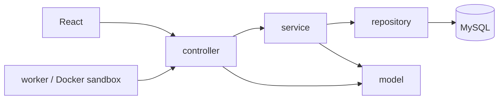

# Backend CodeGrade Network 6.0.0

Backend dùng Layered Architecture, Java 21, Spring Boot, JDBC và Flyway. Giao thức `/ws`, `/worker-ws`, `/api/health`, `/api/meta` giữ nguyên để frontend và worker tiếp tục sử dụng.



## Trách nhiệm các lớp

| Package | Trách nhiệm |
|---|---|
| `controller` | Nhận và kiểm tra envelope, quản lý kết nối/rate limit, gọi service, gửi ACK/event sau khi transaction hoàn tất. Không truy cập repository hoặc JDBC. |
| `service` | Quyền truy cập, luật nghiệp vụ, orchestration và ranh giới transaction. Không chứa SQL. |
| `repository` | SQL có tham số với kiểu dữ liệu cụ thể, ánh xạ dữ liệu và đồng bộ các quan hệ của aggregate. Không gọi service/controller. |
| `model` | User, ProtocolRequest, DomainException, kiểm tra cấu hình đề và thuật toán xếp hạng vòng. Không phụ thuộc Spring/JDBC. |
| `support` | Serialization, ID/thời gian, transaction và ghi event/audit thông qua repository. Không cung cấp JdbcTemplate cho service. |
| `config` | WebSocket, resource handler, scheduling và gọi SeedService lúc khởi động. |
| `worker` | Worker Java độc lập, chỉ gọi WebSocket và chạy bài trong Docker sandbox; không kết nối database. |

Các service chính: IdentityService, ProblemService, SubmissionService, ContestService, SurvivalService, MatchmakingService, ProgressionService, CommunityService, DraftService, AuditService, EventService, WorkerService và SeedService. CommandService điều phối command, kiểm tra requestId và lưu response để retry không lặp tác dụng.

## Luồng xử lý

1. ClientSocketController kiểm tra ProtocolRequest và session.
2. CommandService chọn transaction đọc hoặc transaction ghi có khóa, xác thực lại tài khoản và kiểm tra requestId.
3. Service áp dụng luật nghiệp vụ; repository đọc/ghi dữ liệu bằng prepared statement.
4. Trạng thái, response idempotent và event được commit cùng transaction. Controller gửi ACK sau khi service trả về.
5. WorkerService nhận CLAIM/PROGRESS/RESULT, SubmissionService kiểm tra lease và chấm kết quả trên server. Expected output không được gửi cho worker hoặc đối thủ.

Các command đọc không giữ khóa ghi chung. Snapshot tổng hợp dùng transaction đọc ở mức REPEATABLE_READ. MATCH_QUEUE_STATUS/MATCH_SNAPSHOT vẫn dùng transaction ghi vì cập nhật last_seen. Đăng ký có transaction riêng `identity`; BCrypt được tính trước khi giữ khóa. Thay đổi trận đấu, admission, queue và settlement vẫn được tuần tự hóa bằng khóa `competition` để bảo toàn các giới hạn và thứ tự trước deadline qua nhiều server. Đây vẫn là giới hạn thông lượng ghi; chưa có benchmark chứng minh tốc độ dưới tải.

## Database mới

Schema nằm trong **một file** `src/main/resources/db/migration/V1__initial_schema.sql`. Cấu hình DB_URL/DB_USER/DB_PASSWORD trỏ tới database rỗng, rồi để Flyway tạo schema. Bộ schema này thay thế cấu trúc cũ; không thực hiện chuyển dữ liệu hay tự sửa lịch sử Flyway của database hiện có.

Với Compose, nếu đang dùng volume từ cấu trúc cũ và chấp nhận xóa dữ liệu, chạy tại thư mục Source:

```powershell
docker compose down --volumes
docker compose up -d --build
```

Lệnh đầu xóa volume database của project. Sau khi khởi tạo schema mới, các lần dừng/chạy thông thường dùng `docker compose stop` và `docker compose up -d` để giữ dữ liệu.

Nếu server báo `Access denied for user 'codegrade'`, kiểm tra việc thay `.env` khi vẫn giữ volume MySQL. MYSQL_PASSWORD/MYSQL_ROOT_PASSWORD chỉ được image MySQL áp dụng khi tạo data directory lần đầu; đổi biến môi trường không đổi mật khẩu đã lưu trong volume. Giữ mật khẩu ban đầu hoặc khởi tạo lại volume theo hướng dẫn trên khi bỏ dữ liệu cũ. Healthcheck MySQL chạy `SELECT 1` bằng tài khoản ứng dụng và database cấu hình, để lỗi đăng nhập được phát hiện ngay tại MySQL.

| Nhóm | Bảng |
|---|---|
| Tài khoản | users, sessions, progression |
| Ngân hàng đề | categories, problems, problem_numbers, solved |
| Trận đấu | rooms, room_members, room_problem_bank, room_presence |
| Contest | contests, contest_problems, contest_registrations |
| Chấm bài | submissions, submission_sequence |
| Ghép trận/thưởng | match_queue, match_results, reward_events |
| Cộng đồng | bookmarks, comments, announcements, drafts |
| Hạ tầng | commands, events, audit, transaction_locks |

`room_members`, `room_problem_bank`, `contest_problems`, `contest_registrations` là các quan hệ được repository đồng bộ trong cùng transaction với document. Không cập nhật document bằng SQL ngoài repository: sẽ làm các quan hệ này mất đồng bộ. Chỉ ghi phần quan hệ thay đổi, không xóa và tạo lại toàn bộ bank mỗi lần lưu phòng.

Document JSON được giữ cho cấu hình Question Studio và snapshot của trận/bài nộp, vì snapshot cần đóng băng đầy đủ phiên bản đề. Membership, trạng thái, thời gian contest và các trường dùng lọc/xếp hạng có cột hoặc bảng quan hệ riêng. Snapshot lịch sử không bị thay khi người tạo đề sửa đề.

Các thay đổi truy vấn:

- Tìm phòng của một người và kiểm tra người đang thi đấu dùng quan hệ có chỉ mục, không tải mọi document phòng.
- Kiểm tra đề bị khóa và quyền xem đề contest dùng JOIN theo problem/user, không quét toàn bộ contest/phòng.
- Tính standings contest đọc các lượt nộp bằng một truy vấn rồi nhóm theo user/problem, thay cho truy vấn trong hai vòng lặp.
- Catalog lọc quyền, chủ đề, độ khó và JOIN bookmark/solved trong database; document và mã công khai được đọc cùng truy vấn.
- Thứ tự admission lấy từ sequence O(1), không tính MAX trên lịch sử bài nộp.
- Event feed tách public/personal thành hai nhánh UNION ALL dùng index `(user_id,id)`, sau đó hợp nhất theo sequence.
- Session xác thực bằng một JOIN; progression được tạo khi tạo tài khoản, việc xem stats không ghi database.
- Tick phòng tải presence của cả phòng một lần. Audit chuyển trạng thái lưu snapshot công khai thay vì sao chép toàn bộ private question bank mỗi lần.
- Bổ sung chỉ mục cho lease hết hạn, lịch sử bài nộp, vòng, contest, queue theo room và lịch sử thưởng. Loại bỏ signing_keys/receipts vì chức năng biên nhận đã được loại bỏ.

`dataset.json` vẫn là nguồn seed duy nhất: 320 bài, 1.600 testcase. SeedService chỉ bổ sung bài thiếu khi bật DEMO_DATA và gửi lời giải tham chiếu vào queue VALIDATE thật.

## Kiểm tra

Chạy tại `backend`:

```powershell
mvn clean test
mvn -DskipTests package
```

ArchitectureTest ngăn controller truy cập repository/JDBC, service truy cập JDBC/controller và repository phụ thuộc service/controller. Integration test bao phủ WebSocket, quyền truy cập, judge lease, snapshot/test ẩn, requestId, giới hạn admission, deadline, các mode Survival, matchmaking/rating/EXP, contest, mật khẩu/session, quan hệ phòng/contest, event feed và việc command đọc không chờ khóa ghi trận đấu.

Worker thực thi source vẫn cần Docker. Kiểm thử nghiệp vụ hoặc schema không thay thế smoke test Docker hay kiểm thử tải trên môi trường triển khai.

Kết quả xác minh ngày 30/10/2026:

| Kiểm tra | Kết quả |
|---|---|
| `mvn clean verify`, H2 MySQL mode | 105/105 test đạt, đóng gói Spring Boot JAR thành công |
| Bộ backend trên MySQL 8.0.46 riêng | 104/104 test đạt; sau đó 3 kiểm tra HTTP/WebSocket và 2 kiểm tra lịch sử/leaderboard đạt |
| Schema cuối cùng | Tạo đủ 27 bảng trên MySQL 8.0.46; migration và ranh giới kiến trúc đạt trên H2 |
| Artifact | Có controller/service/repository/model và worker mới; một migration, không có class từ package backend cũ |
| Compose / MySQL 8.4.13 | Khởi tạo database mới và áp dụng V1 thành công; MySQL/server healthy, hai worker kết nối |
| Worker Docker thật | 7/7 kiểm tra: AC với CPP11/CPP17/CPP20/PY311 và WA/CE/TLE với Python |

Các kiểm tra worker Docker được chạy sau khi khắc phục volume MySQL giữ mật khẩu cũ. Chưa đo thông lượng hoặc tải nhiều người chơi; kết quả smoke test không thay thế benchmark tải.
