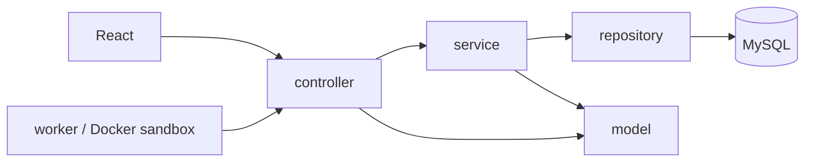

# Backend CodeGrade Network 6.0.0

Backend dùng Layered Architecture, Java 21, Spring Boot 3.5.7, Spring JDBC và Flyway. Server cung cấp WebSocket JSON v1 cho client/worker, hai endpoint HTTP và frontend tĩnh khi đóng gói bằng Docker. Xem [README gốc](../README.md) để cấu hình environment và chạy đầy đủ MySQL/server/worker.



## Trách nhiệm các lớp

| Package | Trách nhiệm |
|---|---|
| `controller` | Nhận và kiểm tra envelope, quản lý kết nối/rate limit, gọi service, gửi ACK/event sau khi transaction hoàn tất. Không truy cập repository hoặc JDBC. |
| `service` | Quyền truy cập, luật nghiệp vụ, orchestration và ranh giới transaction. Không chứa SQL. |
| `repository` | SQL có tham số với kiểu dữ liệu cụ thể, ánh xạ dữ liệu và đồng bộ các quan hệ của aggregate. Không gọi service/controller. |
| `model` | User, ProtocolRequest, DomainException, kiểm tra cấu hình đề và thuật toán xếp hạng vòng. Không phụ thuộc Spring/JDBC. |
| `support` | Serialization, ID/thời gian, transaction và ghi event/audit thông qua repository. Không cung cấp JdbcTemplate cho service. |
| `config` | WebSocket, resource handler, scheduling và gọi SeedService lúc khởi động. |
| `worker` | Worker Java độc lập, chỉ gọi WebSocket và chạy bài trong Docker sandbox; không kết nối database. |

Các service chính: IdentityService, ProblemService, SubmissionService, ContestService, SurvivalService, MatchmakingService, ProgressionService, CommunityService, DraftService, AuditService, EventService, WorkerService và SeedService. CommandService điều phối command, kiểm tra requestId và lưu response để retry không lặp tác dụng.

## Luồng xử lý

1. ClientSocketController kiểm tra ProtocolRequest và session.
2. CommandService chọn transaction đọc hoặc transaction ghi có khóa, xác thực lại tài khoản và kiểm tra requestId.
3. Service áp dụng luật nghiệp vụ; repository đọc/ghi dữ liệu bằng prepared statement.
4. Trạng thái, response idempotent và event được commit cùng transaction. Controller gửi ACK sau khi service trả về.
5. WorkerService nhận CLAIM/PROGRESS/RESULT, SubmissionService kiểm tra lease và chấm kết quả trên server. Expected output không được gửi cho worker hoặc đối thủ.

Các command đọc không giữ khóa ghi chung. Snapshot tổng hợp dùng transaction đọc ở mức REPEATABLE_READ. MATCH_QUEUE_STATUS/MATCH_SNAPSHOT vẫn dùng transaction ghi vì cập nhật last_seen. Đăng ký có transaction riêng `identity`; BCrypt được tính trước khi giữ khóa. Thay đổi trận đấu, admission, queue và settlement vẫn được tuần tự hóa bằng khóa `competition` để bảo toàn các giới hạn và thứ tự trước deadline qua nhiều server. Đây vẫn là giới hạn thông lượng ghi; chưa có benchmark chứng minh tốc độ dưới tải.

## Endpoint và command

| Endpoint | Chức năng |
|---|---|
| `GET /api/health` | Trả `status: UP` và tên dịch vụ; không kiểm tra worker hay chấm bài đầu cuối |
| `GET /api/meta` | Protocol v1, ba role, độ khó 1–6, bốn ngôn ngữ và bốn loại đề |
| `/ws` | `ClientSocketController`: envelope `{v:1,type,requestId,payload}`, ACK và EVENT |
| `/worker-ws` | `WorkerSocketController`: WORKER_AUTH, CLAIM, HEARTBEAT, PROGRESS, RESULT |

Client đăng nhập/đăng ký để nhận token rồi gọi AUTH. Request ID của client cần khớp `[A-Za-z0-9:_-]{1,80}`; payload phải là object. ACK thành công có `data`, ACK lỗi có `error.code`/`error.message`. EVENT dùng sequence tăng dần để phát lại sau AUTH với `lastSeq`. `SYNC` tổng hợp tài khoản, phòng, matchmaking, progression và bài nộp gần đây.

Các nhóm command được điều phối trong `CommandService`:

| Nhóm | Command chính |
|---|---|
| Tài khoản | REGISTER, LOGIN, AUTH, LOGOUT, ME, PROFILE_SAVE, PASSWORD_CHANGE |
| Ngân hàng đề | CATEGORIES, CATEGORY_SAVE, PROBLEMS, QUESTION_GET/EDIT/SAVE/VALIDATE |
| Chấm bài | SUBMIT, PRECHECK, RUN_EXAMPLES, SUBMISSIONS, SUBMISSIONS_PAGE, SUBMISSION_GET, PROBLEM_RANKING |
| Bản nháp | DRAFT_GET/SAVE/CLEAR; server chỉ lưu nháp Practice cá nhân |
| Survival | ROOM_LIST/CREATE/JOIN/SNAPSHOT/TOUCH/CONFIG/START/LEAVE/INVALIDATE |
| Ghép trận | MATCH_QUEUE_JOIN/STATUS/CANCEL, MATCH_SNAPSHOT, MATCH_ACCEPT, MATCH_DECLINE |
| Tiến trình | PROGRESSION_GET, RANKED_LEADERBOARD, MATCH_HISTORY, REWARD_HISTORY |
| Contest | CONTEST_LIST/CREATE/GET/JOIN/APPROVE |
| Cộng đồng/quản trị | BOOKMARK_SET, COMMENTS, COMMENT_ADD, ANNOUNCEMENTS, ANNOUNCEMENT_ADD, USERS, USER_SET, AUDIT |

REGISTER/LOGIN/AUTH/LOGOUT được controller xử lý riêng. Session có thời hạn 12 giờ, database lưu SHA-256 của token; mật khẩu dùng BCrypt cost 11. Đổi mật khẩu/quyền hoặc khóa tài khoản thu hồi các session liên quan. Role được backend kiểm tra lại khi thực thi nghiệp vụ.

## Database

Schema nằm trong **một file** `src/main/resources/db/migration/V1__initial_schema.sql`. Cấu hình DB_URL/DB_USER/DB_PASSWORD trỏ tới database rỗng, rồi để Flyway tạo schema. Bộ schema này thay thế cấu trúc cũ; không thực hiện chuyển dữ liệu hay tự sửa lịch sử Flyway của database hiện có.

Compose tự tạo database/user qua image MySQL. Nếu chạy MySQL riêng trên host, đăng nhập bằng tài khoản quản trị MySQL và tạo trước database/user tương ứng. Ví dụ dưới đây cần thay `<DB_PASSWORD>` bằng mật khẩu sẽ truyền cho backend:

```sql
CREATE DATABASE codegrade CHARACTER SET utf8mb4 COLLATE utf8mb4_bin;
CREATE USER 'codegrade'@'localhost' IDENTIFIED BY '<DB_PASSWORD>';
GRANT ALL PRIVILEGES ON codegrade.* TO 'codegrade'@'localhost';
```

Ví dụ này dành cho backend và MySQL cùng host; nếu kết nối từ container/máy khác, cấu hình host của tài khoản MySQL tương ứng. Không cần nhập schema bằng tay vì Flyway chạy khi ứng dụng khởi động. `.env` của Compose không tự được Spring Boot đọc khi chạy bằng Maven; xem [cách nạp environment](../README.md#phát-triển-ngoài-docker).

Ưu tiên database hoặc Compose project riêng nếu cần giữ dữ liệu cũ. Với Compose, chỉ khi đang dùng volume từ cấu trúc cũ và chấp nhận xóa toàn bộ dữ liệu project, chạy tại thư mục Source:

```powershell
docker compose down --volumes
docker compose up -d --build
```

Lệnh đầu xóa volume database của project. Sau khi khởi tạo schema mới, các lần dừng/chạy thông thường dùng `docker compose stop` và `docker compose up -d` để giữ dữ liệu.

Nếu server báo `Access denied for user 'codegrade'`, kiểm tra việc thay `.env` khi vẫn giữ volume MySQL. MYSQL_PASSWORD/MYSQL_ROOT_PASSWORD chỉ được image MySQL áp dụng khi tạo data directory lần đầu; đổi biến môi trường không đổi mật khẩu đã lưu trong volume. Giữ mật khẩu ban đầu hoặc khởi tạo lại volume theo hướng dẫn trên khi bỏ dữ liệu cũ. Healthcheck MySQL chạy `SELECT 1` bằng tài khoản ứng dụng và database cấu hình, để lỗi đăng nhập được phát hiện ngay tại MySQL.

| Nhóm | Bảng |
|---|---|
| Tài khoản | users, sessions, progression |
| Ngân hàng đề | categories, problems, problem_numbers, solved |
| Trận đấu | rooms, room_members, room_problem_bank, room_presence |
| Contest | contests, contest_problems, contest_registrations |
| Chấm bài | submissions, submission_sequence |
| Ghép trận/thưởng | match_queue, match_results, reward_events |
| Cộng đồng | bookmarks, comments, announcements, drafts |
| Hạ tầng | commands, events, audit, transaction_locks |

`room_members`, `room_problem_bank`, `contest_problems`, `contest_registrations` là các quan hệ được repository đồng bộ trong cùng transaction với document. Không cập nhật document bằng SQL ngoài repository: sẽ làm các quan hệ này mất đồng bộ. Chỉ ghi phần quan hệ thay đổi, không xóa và tạo lại toàn bộ bank mỗi lần lưu phòng.

Document JSON được giữ cho cấu hình Question Studio và snapshot của trận/bài nộp, vì snapshot cần đóng băng đầy đủ phiên bản đề. Membership, trạng thái, thời gian contest và các trường dùng lọc/xếp hạng có cột hoặc bảng quan hệ riêng. Snapshot lịch sử không bị thay khi người tạo đề sửa đề.

Các thay đổi truy vấn:

- Tìm phòng của một người và kiểm tra người đang thi đấu dùng quan hệ có chỉ mục, không tải mọi document phòng.
- Kiểm tra đề bị khóa và quyền xem đề contest dùng JOIN theo problem/user, không quét toàn bộ contest/phòng.
- Tính standings contest đọc các lượt nộp bằng một truy vấn rồi nhóm theo user/problem, thay cho truy vấn trong hai vòng lặp.
- Catalog lọc quyền, chủ đề, độ khó và JOIN bookmark/solved trong database; document và mã công khai được đọc cùng truy vấn.
- Thứ tự admission lấy từ sequence O(1), không tính MAX trên lịch sử bài nộp.
- Event feed tách public/personal thành hai nhánh UNION ALL dùng index `(user_id,id)`, sau đó hợp nhất theo sequence.
- Session xác thực bằng một JOIN; progression được tạo khi tạo tài khoản, việc xem stats không ghi database.
- Tick phòng tải presence của cả phòng một lần. Audit chuyển trạng thái lưu snapshot công khai thay vì sao chép toàn bộ private question bank mỗi lần.
- Bổ sung chỉ mục cho lease hết hạn, lịch sử bài nộp, vòng, contest, queue theo room và lịch sử thưởng. Loại bỏ signing_keys/receipts vì chức năng biên nhận đã được loại bỏ.

`dataset.json` là nguồn seed duy nhất: 320 bài, 1.600 testcase. SeedService chỉ bổ sung bài thiếu theo `general.idNumber` khi bật DEMO_DATA và gửi lời giải tham chiếu vào queue VALIDATE thật. Không tự ghi đè bài hoặc đổi mật khẩu tài khoản đã tồn tại. `ADMIN_PASSWORD` chỉ tạo tài khoản admin khi chưa có tài khoản nào; `WORKER_TOKEN` vẫn bắt buộc khi khởi động, kể cả không bật demo.

## Chấm bài và luật thực thi

`SubmissionService` nhận tối đa 65.536 ký tự source, 4 bài pending mỗi tài khoản, queue toàn hệ thống mặc định 500 (`MAX_QUEUE`). Có bốn mode bài nộp: OFFICIAL, PRECHECK, EXAMPLES và VALIDATE. `RUN_EXAMPLES` chọn test công khai; PRECHECK trong Survival cũng chỉ chạy ví dụ. SUBMISSIONS trả tối đa 100 bản ghi gần đây; SUBMISSIONS_PAGE phân trang toàn lịch sử với pageSize 10/20/50 và filter all/pending/ac/other.

Job chứa source, harness/testcode và stdin; expected output ở lại server. Lease 30 giây, worker heartbeat mỗi 5 giây; kết quả sai worker/token lease, lease hết hạn hoặc job không RUNNING bị từ chối. Lỗi hạ tầng/lease được phục hồi tối đa 3 lượt rồi ghi SE. Mỗi worker xử lý tuần tự một job; tăng số worker để chấm nhiều bài đồng thời.

Worker dùng entrypoint `java -jar ... --worker`, không khởi động Spring/database. Mỗi test chạy trong một container `codegrade-sandbox:5` riêng, không network, root filesystem chỉ đọc, user 65534, bỏ capabilities, giới hạn PID/CPU/RAM/output. RAM thực thi được chặn trong 64–512 MB, CPU 1–10 giây/test; biên dịch có giới hạn riêng 20 giây. Worker yêu cầu Docker/image sẵn sàng và không có fallback chạy source trên host.

Server hỗ trợ EqualityGrader (chuẩn hóa CRLF, bỏ newline cuối), NearEqualityGrader (sai số token số `1e-6 × max(1, abs(expected))`) và RegexGrader dùng RE2/J. Điểm theo trọng số testcase hoặc all-or-nothing. AC lời giải mẫu chỉ cập nhật validatedVersion nếu phiên bản hiện tại còn khớp snapshot.

Đề công bố cần đúng 5 testcase có nội dung. Loại chương trình dùng stdin/stdout; loại hàm nối testcode vào harness. Twig/combinator/preprocessor/prototype nâng cao, TemplateGrader và attachments chỉ lưu cấu hình draft, chưa được runner thực thi. QuestionRules chặn công bố cấu hình không chạy được.

Luật Survival, matchmaking, Contest, Elo/EXP và giới hạn nháp được mô tả tại [README gốc](../README.md). Survival dùng snapshot toàn bank từ COUNTDOWN; Contest lưu danh sách đề và mỗi submission chụp snapshot khi nhận. Không sửa đề đang khóa bởi trận hoặc Contest hoạt động.

## Kiểm tra

Chạy tại `backend`:

```powershell
mvn clean verify
# Tùy chọn xuất kết quả thí nghiệm công bằng (đường dẫn tương đối từ backend).
mvn -Dexperiment.output=../statics/results/fairness-rerun.json test
```

ArchitectureTest ngăn controller truy cập repository/JDBC, service truy cập JDBC/controller và repository phụ thuộc service/controller. Integration test bao phủ WebSocket, quyền truy cập, judge lease, snapshot/test ẩn, requestId, giới hạn admission, deadline, các mode Survival, matchmaking/rating/EXP, contest, mật khẩu/session, quan hệ phòng/contest, event feed và việc command đọc không chờ khóa ghi trận đấu.

Profile `test` dùng H2 MySQL mode, tắt scheduler và demo, có mật khẩu/token fixture; Maven cần Java 21. Các integration test dùng transport/worker mô phỏng cho luật nghiệp vụ. Worker thực thi source vẫn cần Docker; bộ nghiệp vụ/schema không thay thế smoke Docker hoặc kiểm thử tải.

Lần cập nhật README ngày **31/10/2026** chưa chạy lại Maven, MySQL integration hoặc Docker judge; Maven chưa có trên PATH của môi trường cập nhật. Không dùng số liệu 105/105, 104/104 hoặc 7/7 trong README cũ để khẳng định source hiện tại đã được xác minh. Xem [kết quả kiểm tra đã chạy lại](../README.md#kết-quả-kiểm-tra-source-ngày-31102026).

Khóa ghi `competition`, giới hạn 250 kết nối client, rate limit 80 message/10 giây/kết nối và chi phí container/biên dịch từng testcase là các giới hạn cần đo thêm. `benchmark_ws.py` chỉ đo PING RTT/ACK, không chứng minh thông lượng judge hoặc độ trễ thi đấu khi tải cao.
